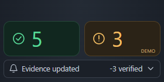

# Keel

**Know what changed, and who reviewed that exact evidence.**
Files have versions. Compliance evidence should too.

Keel adds version-bound control-evidence history and re-review rules to a Box review workflow. When a design package in Box changes, an agent on Amazon Bedrock re-assesses each control against a pinned snapshot of the package. Code validates every quote and records every evaluation. A named reviewer records the disposition against that exact evidence. The machine never says "satisfied" and never turns anything green.

Built for the Box + AWS Agentic Enterprise AI Hackathon, October 16 to 17, 2026.

## The problem in one picture

An architecture review board verified this sentence on October 7 (`demo-data/lantern/architecture-v2.md`, section 4.3):

> All customer data at rest is encrypted using AWS KMS customer-managed keys, rotated annually; key custodians are the Card Servicing Platform leads.

The rewritten document submitted ten days later says this instead (`architecture-v3.md`, section 4.3):

> All customer data is protected with industry-standard encryption, with keys managed through AWS's native key management capabilities.

A hash says the page changed. A reviewer needs to know which control lost which clause, whether it survives elsewhere, and who reviewed which version.

## Who does what

**Box**
- Holds the content and every file version. Keel pins file id, version id and SHA-256 for each file in a snapshot.
- Holds one folder-level metadata instance with the snapshot id and one status field per control.
- Provides tasks as the human surface. The reviewer answers a Box review task. The author receives a Box task.
- Box AI ask, in multi-file mode with citations, is the agent's search tool across the rest of the package.
- Box AI text generation drafts the author's task message. The reviewer sees it before it is sent.

**AWS**
- Bedrock with Claude Sonnet 4.6 (`us.anthropic.claude-sonnet-4-6`) is the single judge. It runs through one Strands TypeScript agent, and its output is validated with Zod.
- Strands Decider 2B runs locally as the input gate. It answers bounded questions with probabilities and never generates text.
- Production hosting and the production ledger are proposed, not built.

**Code**
- A deterministic engine owns all state: quote validation, coverage, staleness, materiality, display rules, the append-only ledger and the Box projection.
- The model has no tool and no output field that writes a disposition or a history.

**A person**
- Only the human response handler writes a disposition. A named reviewer decides, and the decision is bound to the evidence on screen.

## What you see

The reviewer never leaves Box. The app is one page with four things on it, plus a Box file preview.

- **The Box page.** A replica of the Box folder list for Project Lantern's Security Review Package: the Keel wordmark and All Projects in the header, left nav, search, the five files with a Version column, and Box's own **Upload** menu. File names, versions, dates and sizes come from the current snapshot through `GET /api/package`. A dot on a file row means Keel has decisions on that file: amber while one is open, blue once every decision on it is recorded. The **ⓘ** button opens Box's details pane with the folder's `keelReview` metadata fields.
- **The welcome screen.** Above the file list, while the panel is closed, sits the project overview at page size. It shows the project title and application facts, then a "Checked against" header with one badge per framework the profile maps to (ISO 27001:2022, NIST CSF 2.0, PCI DSS 4.0.1, FFIEC IS, GLBA/OCC, each with control and clause counts), the profile line and the "illustrative" mapping caveat. Next comes the changed line with the package timeline as a scrubber. Last is the board: three columns, Need you, Recorded and Hold, each headed by the engine's tile count. Rows fly between columns as decisions land. Clicking a past timeline point shows the board as it stood on that date ("Status on …", **Back to now**). Clicking any row opens that control in the side panel, and the welcome screen folds away toward it. The panel's expand button closes the panel and unfolds the welcome screen again.
- **The owl.** Keel's agent, at the bottom right. It blinks when idle, its pupils sweep while a run works, and it speaks one short line at a time. During a run the bubble shows each step, such as "Re-checking 8 controls on Bedrock…". After the run it shows the summary, such as "1 Critical needs your decision. 2 more to look at.", with a badge counting open decisions. Clicking it opens the panel.
- **The panel, level 1.** Titled **Control review**, 540 px wide. Three tiles count displayed outcomes: Hold, Need you and Recorded. Selecting a tile filters the list to that group. Below them sit the changed line and a package timeline with one point per snapshot, named by date, with the file that changed and the status after it. Clicking a past point shows the status card and each control's status as they stood then. Then come the rows under NEED YOU, ACKNOWLEDGE and RECORDED, one rule per row with its status word and a rule-source chip such as "IS-STD-014 §5.1 · Bank standard". The verifications that hold are folded below.
- **The panel, level 2.** One control. The rule source shows who set the rule up and an illustrative framework map. Next comes the control's own timeline. AGREED is the sentence a named reviewer verified, with who, which version and when. CHANGED shows where the new document changed it, with the new words underlined and an **Open in document ↗** link. Last come one computed verdict line and the buttons the engine enables. Return to author, Verify and Acknowledge expand inline. Each recorded decision shows a three-line receipt, and **Show the record** expands its ledger events and the hash-chain check.
- **The Box file preview.** **Open in document ↗** opens `/files/[fileId]` with Box's preview chrome, the document rendered at its pinned version, and the sentence highlighted with a Keel pill in the margin. The version menu switches between v1, v2 and v3, so the reviewer can see what was there before. The panel stays open beside it.

The panel's **⋯** menu holds everything else: How it works, Status rules, Full record, How it was checked, Other scenarios, Replay a run, Reset demo (mock only) and the mode line. The older full-page routes `/ledger`, `/rules` and `/architecture` remain as deep links with their own header. They are no longer in the navigation, and the same screens open inside the panel from the menu.

The UI never writes machine text. The owl's lines, tiles, timeline labels, row lines, headings, verdict lines and receipts all come from the API, and the status labels come from the engine's display rules. Rule sources and framework maps in the fixture are synthetic and illustrative.

### Screens to capture

Rehearsal captures live locally under `app/.review/v4/` (gitignored). The set that tells the story, in the order of the two-minute script in `docs/demo.md`:

1. Baseline at 1440: the welcome screen with the standards header, the timeline scrubber and the board at Need you 0, Recorded 0, Hold 8. Or the panel open on tiles 8, 0, 0, the package timeline and the eight holding items.
2. A holding item at level 2: the rule chip, the AGREED sentence and who verified it.
3. The Upload menu with **Upload new version**, then the owl working with a step line in its bubble.
4. After the run: tiles 5, 3, 0, the badge, the summary bubble and amber dots.
5. Level 2 for encryption: the rule chip, AGREED above CHANGED, and the verdict line.
6. The control timeline, from "verified by Priya" to "architecture v3 · needs review".
7. The Box AI draft for the author, then the "Returned to author by Dana Okafor" receipt.
8. Level 1 at the close: tiles 5, 2, 1, with encryption under RECORDED.
9. The Box file preview with the sentence highlighted, and the version menu on v2.
10. The Box details pane with the Keel review metadata.
11. Level 1 at 1024x768, where the panel overlays the page.

## The review transaction

1. **Intake.** A submitted document version lands in the Box package folder.
2. **Snapshot.** Keel records a manifest of every file id, version id and SHA-256, plus the control profile version.
3. **Fetch and coverage.** Each file is downloaded by version id. A failed read makes dependent controls `not_evaluated`.
4. **Prior-quote diff.** Code checks each previously cited quote against the new text after disclosed normalization. These are hints, not verdicts.
5. **Input gate.** Decider asks two questions per changed file: is there an injection, and is this change material. Quarantined files never reach Bedrock.
6. **Assessment.** One Strands agent, one Bedrock call per snapshot, per-clause support with quotes. Cross-file search goes through Box AI ask with citations.
7. **Validation.** Every quote must string-match the pinned text. Every control must have exactly one finding.
8. **Staleness.** Code decides whether each prior verification still holds, using the binding and the per-tier materiality rule.
9. **Ledger.** Every evaluation is appended, including the ones that changed nothing.
10. **Projection into Box.** Keel writes folder metadata only if the current snapshot pointer still matches.
11. **Human disposition.** One Box review task per finding. A rejection with a reason returns it to the author. An approval with the attestation phrase verifies it.
12. **Stale action handling.** If a newer snapshot arrived, the action is re-applied when the binding is unchanged. Otherwise it is rejected with an explanation.
13. **Display.** One current outcome per control, with a secondary line naming who verified which file version and when.

## Status model

The rules are published in the app under **⋯** → Status rules in the panel, and at `/rules`. They live in `app/src/lib/engine/display.ts`. First match wins.

1. Evaluation pending: **Re-check pending**
2. Evaluation error or `not_evaluated`: **Not evaluated**, with reason
3. Superseded: **Superseded, re-verify under profile v[n]** (proposed)
4. Not applicable: **Not applicable** (proposed)
5. Exception approved: **Exception approved until [date]** or **Exception expired, re-review due** (proposed)
6. Exception requested: **Exception requested** (proposed)
7. Compensating control: **Compensating control** (proposed)
8. Returned to author on the current binding: **Returned to author, open**
9. Verified on the current binding: **Verified**. This is the only green status.
10. Prior verification holds: **Verified, holds**
11. Prior verification, materiality requires it: **Acknowledge: evidencing file changed** or **Acknowledge: evidencing section changed**
12. Evidence found, binding moved: **Needs review: evidence binding changed** (severity Low)
13. Evidence weakened: **Needs review: [unsupported clause] missing**
14. Evidence absent: **Needs review: evidence lost**
15. Evidence contradicted: **Needs review: conflicting evidence**
16. Otherwise: **Pending review**

**Stored fields.** Machine assessment, change classification, per-clause support, human disposition, evaluation state, and verification holds. Machine events record `current_disposition` and a `prior_verification` block. They never carry a human disposition.

**Materiality by tier.** A prior verification holds only when the classification is `unchanged` and the tier rule permits it.

| Tier | Requires a human acknowledgment when |
| --- | --- |
| Critical | the evidencing file changed, even if the quote is unchanged |
| High | the evidencing section text changed, even if the quote is unchanged |
| Medium | never, as long as the quote is unchanged |

## Run it

Mock mode is the default and needs no credentials. It runs the same engine against in-memory Box and a fixture evaluator.

```
cd app
npm install
npm run dev          # http://localhost:3000
npm test             # Vitest, including acceptance cases 1 to 20 from the spec
npm run typecheck
```

On the Box page, choose **Upload ▾** → **Upload new version** → **Upload** to submit the rewritten architecture document and start the run. Click the owl to open the panel. To start over, open the panel's **⋯** menu and press **Reset demo**. The presenter script is in `docs/demo.md`. The talk track is in `presentation/README.md`.

For a demo, run production mode instead: `npm run build && npm run start`.

## Go live

Set `MOCK_MODE=false` in `app/.env.local` (copy from `app/.env.example`, never commit it). The full runbook, Box app scopes and scripts are in `docs/INTEGRATION.md`.

| Variable | Purpose |
| --- | --- |
| `MOCK_MODE` | `true` by default. `false` swaps in the real Box adapter, Bedrock evaluator and Decider gate |
| `AWS_REGION` | `us-east-1`. Credentials come from the default AWS chain |
| `KEEL_INFERENCE_PROFILE` | Sent to Bedrock as the model id. Default `us.anthropic.claude-sonnet-4-6` |
| `KEEL_MODEL_ID`, `KEEL_MRM_MODEL_ID`, `KEEL_PROMPT_VERSION` | Recorded on every event |
| `BOX_DEVELOPER_TOKEN` | Quick path. Expires after 60 minutes |
| `BOX_CLIENT_ID`, `BOX_CLIENT_SECRET`, `BOX_ENTERPRISE_ID` | Client credentials grant, the demo path |
| `BOX_SUBJECT_USER_ID` | Optional As-User header |
| `BOX_FOLDER_ID` | The package folder |
| `BOX_METADATA_TEMPLATE_KEY`, `BOX_METADATA_SCOPE` | `keelReview`, `enterprise` |
| `KEEL_REVIEWER_NAME`, `KEEL_REVIEWER_ROLE`, `KEEL_REVIEWER_LOGIN` | The configured reviewer |
| `KEEL_AUTHOR_NAME`, `KEEL_AUTHOR_LOGIN` | The configured author |
| `DECIDER_URL` | Local Decider server. Empty means the gate step is omitted from the trace |

## Repository map

| Path | Contents |
| --- | --- |
| `app/` | Next.js app: engine, ledger, store, Box adapter, Strands agent, API routes and UI |
| `app/src/components/box/`, `owl/`, `panel/` | The experience layer: Box page replica and file preview, the owl, the Keel panel |
| `demo-data/lantern/` | Synthetic fixture: five files, eight controls, snapshots S1 to S4, hash-chained seed ledger, expected findings |
| `demo/keel.html` | Standalone explainer page |
| `demo/intro/` | Intro page for the talk (`keel-intro.html`, rendered by `render.py`) |
| `demo/index.html` | Earlier EpistemicBox prototype (idea #2), kept for history |
| `desktop-client/` | Desktop HUD prototype for Windows and macOS (Electron, or Python Tkinter). See below |
| `presentation/README.md` | Two-minute talk track |
| `docs/research/` | Design history: spec v3.4 in `30-design-v3.md`, with the Codex and persona review rounds for each version |
| `docs/CONTRACTS.md` | Frozen shapes, adapter interface and API routes |
| `docs/INTEGRATION.md` | Mock-to-live runbook |
| `docs/architecture.md` | Component and sequence diagrams, trust boundaries, ledger envelope |
| `docs/demo.md` | Presenter runbook and judge questions |

### Desktop client prototype

`desktop-client/` holds a separate desktop HUD for Windows and macOS (details and screenshots in [`desktop-client/README.md`](desktop-client/README.md)). It is a frameless, draggable two-tile widget. One tile counts verifications that hold and the other counts items that need review. It accepts files and folders dropped onto it for upload to the Box package folder, subscribes to a folder topic to show teammate file-drop notifications, has a small config sheet, and opens the web UI on click. It runs as Electron (`main.js`, `preload.js`, `widget.html`) or as a zero-install Python Tkinter widget (`keel_desktop_client.py`).

It is a prototype outside the Next.js app. It does not call the engine's API, and its tile labels ("COMPLIANT", "UNMET") do not follow the app's wording rules. Do not demo it as the product surface.



## Built on Saturday vs proposed

**Built**
- Next.js app with mock mode by default and real mode on the integration laptop. The mode label is always visible.
- Snapshot and coverage from Box folder items, versions, download by version, SHA-256 and a manifest.
- One Strands TypeScript agent on Bedrock with Zod-validated output, read tools constrained to the snapshot, and no write tools.
- Box AI ask as the `search_snapshot` tool, with citation validation and a string-search fallback.
- Strands Decider 2B as the local input gate. It is omitted from the trace, not faked, when it is not running.
- Box AI text generation for the author task message.
- Deterministic layer: prior-quote diff, quote validation, coverage check, staleness and materiality, display rules, hash-chained JSON ledger, disposition handler with re-apply logic.
- Box writes: folder metadata, a reviewer task per finding, an author task on return, task polling with identity capture.
- A project welcome screen on the folder page: the frameworks the profile maps to, a timeline scrubber that shows the status on any past snapshot, and a Need you / Recorded / Hold board.
- A Box folder replica with the owl and one side panel: overview tiles that filter the list, package and control timelines, rule-source chips, the AGREED and CHANGED evidence pair, inline Return to author, Verify and Acknowledge, receipts with the record, and a menu for the rules, the full ledger with export, the run trace, replay and reset.
- A Box file preview with a version menu that highlights the cited sentence at its pinned version.

**Proposed, not built**
- Box webhook to a Lambda URL with signature verification, EventBridge, and SQS FIFO per folder.
- The same agent on AgentCore Runtime with Observability. AgentCore Identity for Box OAuth.
- DynamoDB ledger with Streams to S3 Object Lock.
- ServiceNow IRM for exceptions and Jira for author work.
- Box Automate calling Keel as its judgment step. Untested.
- Batch mode for a shadow evaluation over historical package versions.

## Readiness

**Built:** snapshot-bound evaluation, evidence-binding staleness with per-tier materiality, separate machine and human fields with published display rules, per-clause support, quote validation with disclosed normalization, every evaluation recorded, model id and MRM model id and prompt version on every event, folder projection with snapshot id, reviewer identity from the Box task response, stale-action re-apply or explained rejection.

**Product work, proposed, in order:** author routing to Jira, not-applicable with second-reviewer approval, compensating control, exception record and IRM mirror, batch shadow evaluation, completeness reconciliation against Box's version list, production ledger and integrity controls, webhook trigger and AgentCore hosting, diagram and image reading.

**Bank-owned gates, in order:** data-classification decision for sending Confidential documents to Bedrock, model risk intake and MRM model id, review-board role validity and project membership from the directory, source-permission enforcement on quotes shown, third-party risk review of the vendor, metadata template governance on the Box tenant.

## Measured and claimed

One synthetic probe during research caught a planted removal in a 7-page document with 12 controls. It took 10 to 17 seconds of model time, under a different inference profile and region. We quote it as that and nothing more.

The full upload-to-display path is measured during rehearsal. The number shown on screen is the number from the run. Mock mode runs on compressed timing and says so on screen.

## Data handling

Demo documents are synthetic. In live mode, document text leaves Box for the laptop and for the Bedrock request under a `us.` inference profile in us-east-1. It is stored in the local ledger. The inference profile is a routing choice, not a residency guarantee.

A pilot requires a data-classification decision for Confidential documents, model risk intake, verified processing and logging destinations, and retention rules for every copy.

## Synthetic data

Meridian Trust Bank, Project Lantern, and every person, vendor, ticket and identifier in this repository are fictional. Box deep links, record URLs and the MRM model id in the fixture are placeholders.
