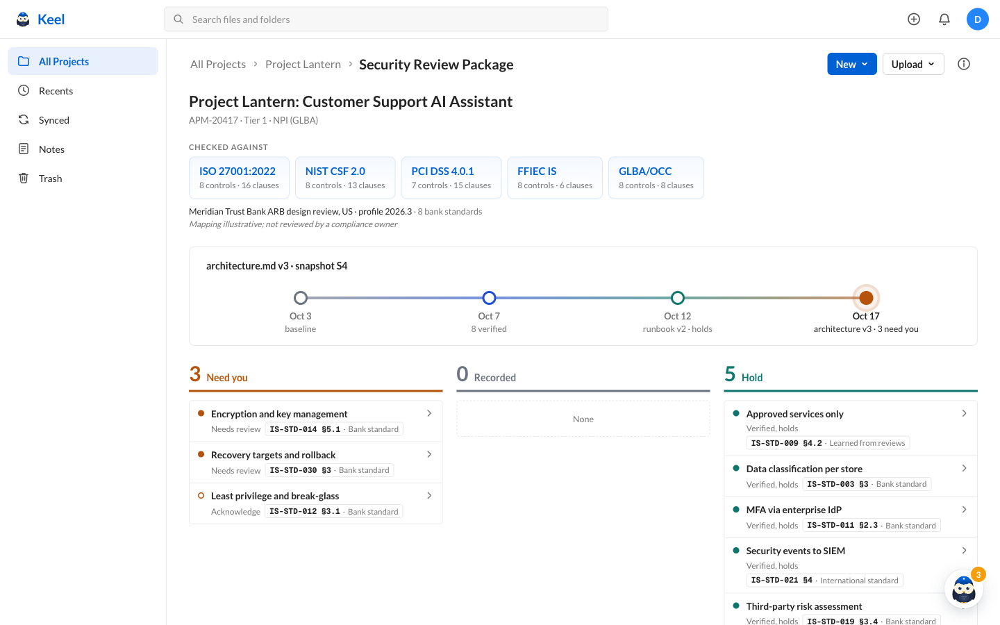
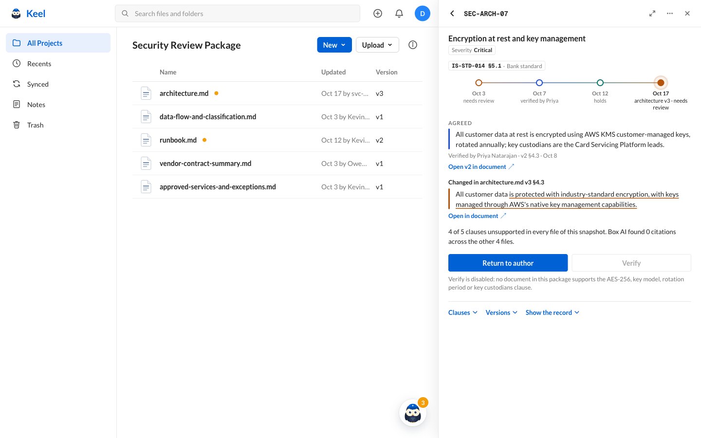

<p align="center"></p>

<h1 align="center">Keel</h1>

<p align="center"><b>Know what changed, and who reviewed that exact evidence.</b><br>Files have versions. Compliance evidence should too.</p>

When a design package in Box changes, Keel re-checks each control against a pinned snapshot of the package. An agent on Amazon Bedrock assesses the evidence, code validates every quote and records every evaluation, and a named reviewer decides. The machine never says "satisfied" and never turns anything green.

Built for the Box + AWS Agentic Enterprise AI Hackathon, October 16 to 17, 2026.



## The problem

A review board verified this sentence in `architecture.md` v2:

> All customer data at rest is encrypted using AWS KMS customer-managed keys, rotated annually; key custodians are the Card Servicing Platform leads.

Ten days later, v3 says:

> All customer data is protected with industry-standard encryption, with keys managed through AWS's native key management capabilities.

A file hash says the page changed. A reviewer needs to know which control lost which clause, whether the evidence survives elsewhere, and who reviewed which version.

## How it works

1. A new file version lands in the Box package folder.
2. Keel pins a snapshot: every file id, version id and SHA-256.
3. Strands Decider 2B screens the changed files for injected instructions. Flagged files never reach Bedrock.
4. One Strands agent on Bedrock (Claude Sonnet 4.6) assesses each control clause by clause, using Box AI ask to search the rest of the package.
5. Code checks every quote against the pinned text, decides whether each earlier verification still holds, and appends everything to a hash-chained ledger.
6. Keel writes the status to Box folder metadata and opens a Box task for each finding.
7. A reviewer verifies, acknowledges or returns each one to the author. Box AI drafts the author's task. Only a person writes a decision.

## What you see



The reviewer stays on a Box folder page (a replica in mock mode):

- **Welcome screen.** The frameworks the controls map to, a package timeline you can click back through, and a board with three columns:
  - **Need you.** The evidence changed, and a person must decide.
  - **Recorded.** A person has decided on this version.
  - **Still verified.** An earlier verification still applies, because the sentence it relied on is unchanged.
- **The owl.** Keel's agent. It narrates the run one line at a time and badges the number of open decisions.
- **Side panel.** One control: what was **agreed**, what **changed**, a computed verdict, and only the actions the engine allows. **Open in document ↗** shows the sentence highlighted in a Box-style preview at its pinned version.

Every label and line comes from the engine. The UI composes no machine text. The 16 status rules are in the app under **⋯ → Status rules** and in `app/src/lib/engine/display.ts`.

## Run it

Mock mode is the default and needs no credentials. It runs the same engine against an in-memory Box and fixture agent output.

```bash
cd app
npm install
npm run dev        # http://localhost:3000
npm test           # Vitest, including the spec's acceptance cases
npm run typecheck
```

Choose **Upload ▾ → Upload new version → Upload** to start a run. **⋯ → Reset demo** starts over. For the demo itself, use `npm run build && npm run start`.

**Live mode:** set `MOCK_MODE=false` in `app/.env.local` (copy `app/.env.example`, never commit it). The runbook is [`docs/INTEGRATION.md`](docs/INTEGRATION.md).

## Built vs proposed

**Built.** Snapshot pinning from Box versions, the Decider input gate, the Bedrock agent with Zod-validated output and read-only tools, Box AI ask search and task drafting, quote validation, staleness with per-tier materiality, the hash-chained ledger, Box metadata and task writes, and the Box-replica UI.

**Proposed.** Box webhooks to Lambda and SQS, AgentCore hosting, a DynamoDB ledger with S3 Object Lock, ServiceNow and Jira routing, exceptions and compensating controls, and batch shadow evaluation.

## Repository

| Path | Contents |
| --- | --- |
| `app/` | The Next.js app: engine, ledger, Box adapter, agent, API and UI |
| `demo-data/lantern/` | Synthetic fixture: five files, eight controls, four snapshots |
| `demo/` | Talk opener and demo reel |
| `docs/` | [Contracts](docs/CONTRACTS.md), [architecture](docs/architecture.md), [presenter runbook](docs/demo.md), [integration](docs/INTEGRATION.md), spec v3.4 in [`docs/research/`](docs/research/30-design-v3.md) |
| `presentation/` | Talk track |
| `archive/` | Earlier ideas and prototypes, including the desktop client ([index](archive/README.md)) |

## Honesty notes

- All data is synthetic. Meridian Trust Bank, Project Lantern and every person in them are fictional. The framework mappings are illustrative.
- In live mode, document text goes to Bedrock under a `us.` inference profile in us-east-1. That is a routing choice, not a residency guarantee.
- We have no accuracy benchmark. One research probe caught a planted removal in a 7-page document in 10 to 17 seconds of model time. Mock mode runs on compressed timing and says so on screen.
