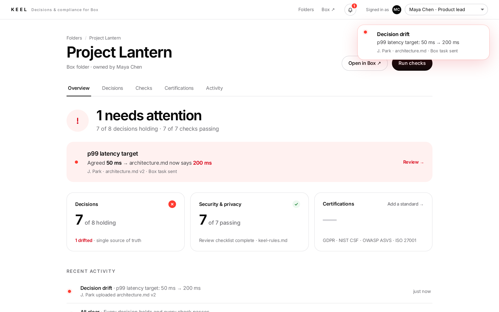

# Keel: decisions and compliance for Box

**One source of truth for every project decision, checked on every upload to Box.**

| What we solve | How Keel does it |
| --- | --- |
| **One source of truth for decisions** | Keel reads every document in a Box project folder and extracts what the team decided: targets, regions, owners, policies. Nobody maintains a list by hand. |
| **Decision drift, with an audit trail** | When an upload contradicts an agreed decision, Keel flags the drift, quotes both sides, and records who changed what. |
| **Certificate compliance** | Standards (GDPR, NIST CSF, OWASP ASVS, internal checklists) install as versioned rule packs and show as certification badges. |
| **Security & privacy review** | Plain-language rules in the folder are checked on every upload, with verified quotes. |
| **Team productivity** | Only the person whose upload caused a problem gets a Box task. Everyone else sees green. |

**Status:** a local build that runs on one machine. *Fake Box*, a Box-shaped API and UI, stands in for Box. SQLite stand-ins replace Lambda, SQS FIFO and DynamoDB, with the same limits as the real services. The demo uses deterministic offline extraction and judging. Bedrock agents are wired in but have not been run end to end yet.

- [`keel/README.md`](keel/README.md): how to run it, the user flow, and the architecture
- [`keel/demo/videos/keel-demo.mp4`](keel/demo/videos/keel-demo.mp4): the ~1-minute demo, plus [`keel-certifications.mp4`](keel/demo/videos/keel-certifications.mp4)
- [`docs/v1-local-design.md`](docs/v1-local-design.md): design decisions, Box and AWS constraints with sources, and the swap plan

```bash
cd keel && ./dev.sh --seed-connected   # Keel on http://localhost:3000, Fake Box on /box
```



## Earlier explorations

The repository also keeps the research and earlier designs that led here. They describe earlier ideas, not the current build.

- [`docs/idea-selection.md`](docs/idea-selection.md) and [`docs/idea3-discussion.md`](docs/idea3-discussion.md): comparison of the three hackathon ideas
- [`docs/one-pager.md`](docs/one-pager.md): idea #1, epistemic review
- [`docs/architecture.md`](docs/architecture.md), [`docs/demo.md`](docs/demo.md), [`docs/idea-evolution.md`](docs/idea-evolution.md), [`demo/index.html`](demo/index.html): idea #2, EpistemicBox / agreement drift
- [`docs/research/30-design-v3.md`](docs/research/30-design-v3.md), [`demo-data/lantern/`](demo-data/lantern), [`demo/keel.html`](demo/keel.html): Keel v3.4, version-bound human verification of control evidence. The current build reuses its name and synthetic bank scenario.
- [`desktop-client/`](desktop-client/README.md): desktop HUD prototype (mocked; not part of v1)
