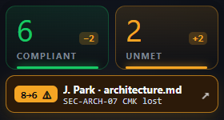
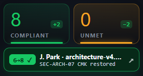
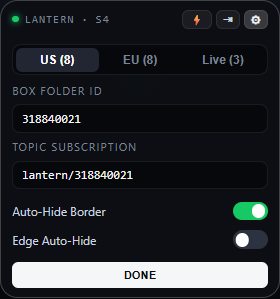

# KEEL · Tesla-Inspired Cross-Platform Desktop Client (Windows & macOS)

An ultra-clean, frameless, **draggable desktop compliance HUD** inspired by **Tesla OS / Tesla Energy HMI design**, engineered to run on both **Windows (`win32`)** and **macOS (`darwin`)**.

It connects a team's shared **Box Package Folder** (`318840021 · Project Lantern`) to the **AWS + Box AI** compliance evaluation pipeline (`Strands Decider 2B` input gate $\rightarrow$ `Bedrock Claude Sonnet 4.6` + `Box AI Ask` citation search $\rightarrow$ `Box Folder Metadata & Tasks`).

---

## Visual Walkthrough & Screenshots

### 1. Borderless Auto-Hide Idle HUD (`224px` Ultra-Compact Footprint)

- **Auto-Hide Border & Chrome:** In idle state on the desktop, the outer window frame and top bar completely auto-hide (`border: transparent`, top micro-bar height `0px`). Only the two floating obsidian tiles and the active 1-line delta notification pill are visible. Hovering over the widget smoothly reveals the top micro-bar (`● LANTERN · S4`, `⚡` simulate drop, `⇥` edge auto-hide dock, `⚙` config).
- **Screen-Edge Auto-Hide (`⇥`):** Can also tuck into the right edge of the screen and automatically peek out for 4 seconds whenever a teammate file-drop event arrives on the subscribed topic.
- **Left Green Tile (`COMPLIANT`):** Big tabular numeral (`6`) + live delta badge (`−2`) + bottom green laser bar (`#17c964`).
- **Right Amber/Yellow Tile (`UNMET`):** Big tabular numeral (`2`) + live delta badge (`+2`) + bottom amber laser bar (`#f5a524`).
- **Zero-Space Drag & Drop:** The entire two-box rectangle itself is the file/folder drop zone (`⇣ DROP TO BOX` translucent overlay appears only while dragging files/folders over it).
- **High-Intention 1-Line Notification Pill (`8→6 ⚠`):** Amber-highlighted badge immediately shows **direction (`8→6 ⚠`)**, **who + file (`J. Park · architecture.md`)**, and **which clause changed (`SEC-ARCH-07 CMK lost`)**.



---

### 2. Teammate File Drop Satisfies Compliance (`6→8 ✓` Emerald Intention)

When a teammate drops a remediated file (`architecture-v4.md`), the notification pill flips to **Emerald Green (`6→8 ✓`)** and the tile deltas flip to **`+2`** / **`−2`**:



---

### 3. Ultra-Compact Tesla Configuration Sheet (`⚙`)

Hovering the widget and clicking **`⚙`** swaps the interior of the same `224px` rectangle into a minimal Tesla settings sheet (`US (8) | EU (8) | Live (3)` segmented control, `Box Folder ID`, `Topic Subscription`, `Auto-Hide Border` switch, and `Edge Auto-Hide` switch):



---

### 4. One-Click Web Interface Popover (`↗`)

Clicking the **Left Green Tile**, the **Right Yellow Tile**, or the **Notification Pill** opens a compact popover summary with a **`WEB UI ↗`** button to launch the full Web Interface ([`../demo/index.html`](../demo/index.html)):


---

## Architecture & File Structure

```text
desktop-client/
├── README.md                        # Documentation & Tesla HMI visual guide
├── widget.html                      # Tesla-inspired draggable 2-box HUD + Config + Popup UI
├── main.js                          # Electron main process (Windows & macOS frameless always-on-top window)
├── preload.js                       # Electron contextBridge IPC (topic pub/sub + Web UI popup launcher)
├── package.json                     # Cross-platform Electron manifest (win32, darwin, linux)
├── keel_desktop_client.py           # Zero-install Python Tkinter desktop widget + local HTTP/SSE topic broker
└── screenshots/
    ├── hud-main.png                 # Main 2-Box HUD (6 Compliant | 2 Not Yet Compliant)
    ├── hud-teammate-drop-satisfied.png # After teammate file drop satisfies compliance (8 | 0)
    ├── hud-config.png               # Tesla-style Configuration Panel
    └── hud-web-popup.png            # Popup Web Interface Detail Drawer
```

---

## Running on Windows & macOS

### Option A: Zero-Install HTML / Browser HUD Preview

Open [`desktop-client/widget.html`](widget.html) directly in any browser on Windows or macOS.

### Option B: Electron Native Frameless Desktop App (Windows & macOS)

```bash
cd desktop-client
npm install
npm start
```

### Option C: Zero-Dependency Python Native Widget + Local Topic Broker (Windows & macOS)

```bash
python desktop-client/keel_desktop_client.py
```
