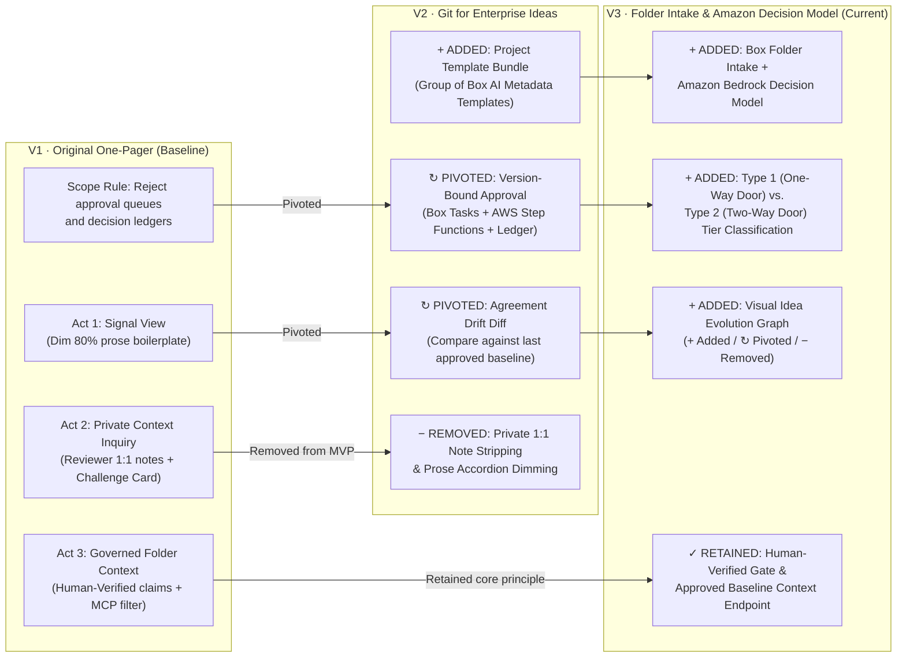

# Idea Evolution History: Dogfooding EpistemicBox on Itself

**EpistemicBox tracks how enterprise ideas evolve across revisions (`+ Added`, `↻ Pivoted`, `− Removed`, `✓ Retained`).**
This document is our own dogfooding trail: how the **EpistemicBox** concept evolved from the initial One-Pager (`V1`) to our current Box + AWS architecture (`V3`).

---

## 1. Visual Revision Lineage (`V1 -> V2 -> V3`)



---

## 2. Structured Evolution Ledger (`V1` One-Pager vs. `V3` Current Design)

| Status | Concept / Claim | V1: Original One-Pager | V3: Current EpistemicBox | Why It Changed & Impact |
| --- | --- | --- | --- | --- |
| **✓ RETAINED** | **Core Problem: AI "Workslop" & Review Bottleneck** | Generative AI makes 10-page drafts effortless, shifting cognitive load from writer to reviewer while unverified claims pollute Box folders. | **Unchanged.** High-fluency drafts hide high-consequence changes inside plausible prose. | Core business motivation remains identical. |
| **✓ RETAINED** | **Human-in-the-Loop Epistemic Gate** | Only a Human Reviewer can upgrade a claim to `Human-Verified`; AI cannot self-approve. | **Unchanged.** AI extracts and flags drift; only assigned human reviewers in Box Tasks can approve a baseline promotion. | Preserves the strict trust boundary between AI analysis and human accountability. |
| **✓ RETAINED** | **Governed Downstream Context** | Downstream agents should only receive `Human-Verified` claims, not unexamined or challenged prose. | **Retained as the Approved Context Endpoint:** serves only the exact accepted revision manifest (`ApprovedBaseline`), never unapproved drafts. | Prevents unapproved V2/V3 drafts from poisoning downstream workflows. |
| **↻ PIVOTED** | **Primary Review Unit: Prose Dimming → Agreement Drift Diff** | **Act 1 (Signal View):** Dim 80% of a single document into accordions and highlight 5–7 load-bearing claims. | **Change Review (Git-style Diff for Ideas):** Compare a candidate revision against the **last approved baseline**, surfacing `+ Added`, `↻ Pivoted`, and `− Removed` commitments with before/after quotes. | Enterprise teams rarely ask "is this paragraph filler?" in isolation—they ask **"what changed since we last agreed, and when?"** |
| **↻ PIVOTED** | **Extraction Schema: Ad-hoc Claim Tags → Project Template Bundle** | Generic file/claim badges (`Grounded in Folder`, `Unexamined Bet`, `Private Context Conflict`). | **Project Template = Group of Box Metadata Templates** (`Business Case`, `Architecture`, `Data & Privacy`, `Finance`) generated from reference files in Box Extract. | Different enterprise proposals need domain-specific review schemas rather than one generic claim tag. |
| **↻ PIVOTED** | **Workflow Stance: No Approval Queues → Version-Bound Approval Trail** | Section 5 explicitly rejected approval/sign-off queues and decision ledgers. | **Core feature:** Generates a version-bound **Review Packet** in Box, assigns **Box Tasks** by policy role, orchestrates via **AWS Step Functions**, and records an **auditable Decision Ledger**. | User requirement shifted to an auditable trail of idea evolution and team agreement ("Git for ideas"). |
| **+ ADDED** | **Folder Intake + Amazon Bedrock Decision Model** | *Not present in V1 (assumed single-document opening in Box).* | Project owner uploads a **Box folder of documents**; **Amazon Bedrock** classifies **Type 1 (One-Way Door) vs. Type 2 (Two-Way Door)** decisions, recommends the **Project Template**, and maps each file to its template role. | Removes manual setup friction and gives AWS Bedrock a clear, non-duplicated decision-triage role alongside Box AI. |
| **+ ADDED** | **Visual Idea Evolution History (`+ Added` / `↻ Pivoted` / `− Removed`)** | *Not present in V1 (only showed current verification ratio).* | Visualizes idea lineage across revisions (`V1 -> V2 -> V3`) with explicit badges for **Added**, **Pivoted**, **Removed**, and **Retained** sub-ideas. | Makes architectural pivots and silently dropped constraints immediately visible to stakeholders. |
| **− REMOVED** | **Reviewer Private 1:1 Note Inquiry & Citation Stripping** | **Act 2 (Inquiry Workbench):** Reviewer queries private 1:1 Box notes and strips private citations before posting a public Challenge Card. | **Scoped out of MVP.** | Stripping citations cannot guarantee zero semantic leakage of private notes, and private-note RAG detracts from the core shared-agreement workflow in a 3-minute demo. |
| **− REMOVED** | **Folder Verification Ratio Score (e.g., "90% Verified")** | **Act 3:** Display a percentage ratio of verified vs. unexamined prose per file/folder. | **Removed.** Replaced by explicit revision status (`Approved Baseline V1`, `Pending Review V2`, `Superseded`, `Rejected`). | A single unapproved change to data residency (`EU -> US`) is a blocker even if 95% of the document is unchanged; percentage scores hide Type-1 risks. |

---

## 3. How EpistemicBox Renders This Visually in the Product UI

Because enterprise proposals evolve just like our own project did, the Idea Hub UI includes an **Idea Evolution History** view alongside field-level diffs:

```text
┌──────────────────────────────────────────────────────────────────────────────┐
│ Project: EpistemicBox Hackathon Proposal                                     │
│ Recommended Template: Enterprise AI Initiative (v1) • Tier: Type 1 Door      │
├──────────────┬───────────────────────────────────────────────────────────────┤
│ Commit Trail │ Visual Idea Diff (V1 One-Pager ──► V3 Folder + Decision Hub)  │
│              │                                                               │
│ ● V3 Current │ [ + ADDED ]  Folder Intake & Amazon Bedrock Decision Model    │
│ │ 21:20 PDT  │              Suggests Project Template & Type 1/2 tier        │
│ │            │              across an uploaded Box folder.                   │
│ ● V2 Pivot   │                                                               │
│ │ 20:58 PDT  │ [ ↻ PIVOTED ] Prose Dimming ──► Baseline Agreement Drift      │
│ │            │              Before (V1): Dim 80% of a single doc's prose.    │
│ ● V1 Base    │              After  (V3): Diff candidate vs. approved         │
│   One-Pager  │              baseline using grouped Box Metadata Templates.   │
│              │                                                               │
│              │ [ ↻ PIVOTED ] No Approval Queues ──► Box Tasks + AWS Ledger   │
│              │              Before (V1): Explicitly excluded sign-off flows. │
│              │              After  (V3): Version-bound Box Tasks & Step      │
│              │              Functions audit trail.                           │
│              │                                                               │
│              │ [ − REMOVED ] Reviewer Private 1:1 Note Citation Stripping    │
│              │              Dropped from MVP due to semantic leakage risk    │
│              │              and to focus on shared team agreement.           │
│              │                                                               │
│              │ [ ✓ RETAINED ] Human-Verified Gate & Governed Context Output  │
└──────────────┴───────────────────────────────────────────────────────────────┘
```

### Why `+ Added / ↻ Pivoted / − Removed` Matters in Enterprise Reviews

1. **`− REMOVED` catches silent constraint drops:** When an author deletes a security constraint or scopes out a safeguard, a simple summary of the new document will never mention what disappeared.
2. **`↻ PIVOTED` explains architectural direction changes:** Stakeholders can see *what the idea used to be*, *what it became*, *when the pivot entered Box*, and *who approved the pivot*.
3. **`+ ADDED` highlights new commitments:** New scope, new budget items, or new data dependencies stand out immediately for targeted review.
