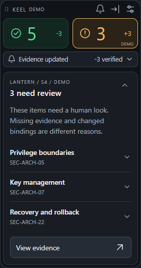
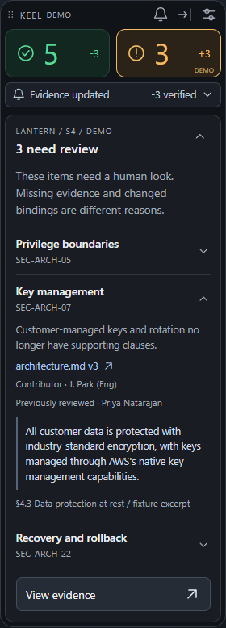
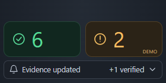
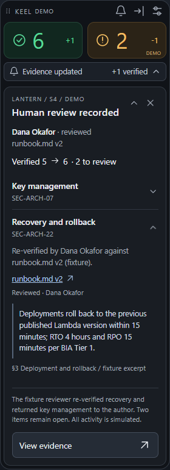
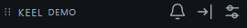

<div align="center">

# KEEL / Desktop

**A glance for status. A hover for context. A click for evidence.**

`224 px` &nbsp; `Tauri + system WebView` &nbsp; `Windows / macOS`


[Interaction guide](#glance-hover-act) &middot;
[Install and connect](#install-then-click-a-project-link) &middot;
[Build](#preview-and-development) &middot;
[Integration contract](project-connection.md)

</div>

---

A small, configurable evidence-review widget using **Tauri and the system
WebView**: WebView2 on Windows, WKWebView on macOS. The interface is plain
HTML/CSS/JavaScript. No Python runtime, Electron, bundled Chromium or frontend
framework.

The visual treatment uses restrained automotive-instrument-panel cues: dark
surfaces, thin strokes, quiet typography, two status colors. No Tesla assets or
branding are included.

> **Delivery status:** working local UI and native client transport. Windows
> ARM64 builds and NSIS packaging are verified here. macOS and Windows x64
> installer builds are configured for CI, not claimed as tested on this machine.
> Box uploads and the project backend remain separate integrations.

## Glance, hover, act

The idle surface is **224 CSS pixels wide** and at most **112 pixels tall** with
a notification. It shows two icon counters, not long labels:

- Green check: evidence with a human verification that still holds.
- Amber review icon: evidence needing attention, including an acknowledgment,
  missing clauses or an open remediation. This is **not** a legal verdict of
  non-compliance.
- A **neutral bell notification** reports the change separately: `-3 verified`
  or `+1 verified`. Its color does not duplicate the current-state counters.

### Progressive disclosure

| Gesture | Result |
| --- | --- |
| Hover a counter for 160 ms | Preview that set of checklist items |
| Move into the preview | Keep it open; no pointer gap or flicker |
| Leave the widget | Collapse an unpinned preview after 280 ms |
| Click an item, or hover its heading for 550 ms | Expand its accordion with source, contributor/reviewer and excerpt |
| Leave a hover-opened item | Retract it; a clicked item stays open until collapsed |
| Click another item | Close the previous accordion to save space |
| Click a source | Open its evidence directly, without another dashboard step |
| Click a counter | Open the filtered web details |

Only one checklist accordion is open at a time. All controls have accessible
names and keyboard equivalents; status never relies on color alone. Motion
respects `prefers-reduced-motion`. Long-hover expansion is limited to the widget;
the full evidence page uses click-to-expand to keep document scrolling stable.

<table>
  <tr><th>1. Hover: scan the checklist</th><th>2. Dwell or click: inspect one item</th></tr>
  <tr>
    <td valign="top"></td>
    <td valign="top"></td>
  </tr>
  <tr><td>No competing panels or repeated warnings.</td><td>Source, person and excerpt are one gesture away.</td></tr>
</table>

### Notifications are reversible

Hover previews a notification. Click its chevron to pin it; click again to
collapse. The panel has separate **collapse** and **dismiss** controls.
Escape, an outside click or losing window focus closes the panel. Dismiss
removes the notification strip, not the review state; the bell recalls the
latest event. A new event can appear without opening a full panel.

Both directions are represented: a file change can invalidate prior evidence;
a **subsequent human review**, not the upload itself, can restore verification.
The current Lantern fixture is `5 verified / 3 to review`, then `6 / 2` after
the recorded human responses. The unresolved items do not turn green.

<table>
  <tr><th>Evidence changed</th><th>Human review recorded</th></tr>
  <tr>
    <td></td>
    <td></td>
  </tr>
  <tr><td>Neutral notification: <code>-3 verified</code>.</td><td>Same neutral notification: <code>+1 verified</code>.</td></tr>
</table>

<details>
<summary>See the expanded notification, with separate collapse and dismiss controls</summary>



</details>

### Settings and desktop behavior

Hover or focus the widget to reveal its drag handle and settings button.
Settings persist locally: always-on-top, border visibility, edge auto-hide and
notifications. An optional project web URL must use HTTPS.

The native window follows the content height so hover panels and settings do
not get cut off. Edge auto-hide shrinks the **native window**, not just a CSS
element, to an 8-pixel handle at the monitor's work-area edge. Hover reveals it.
The browser preview only simulates that interaction within the page.

<details>
<summary>See local settings</summary>


</details>

## Install, then click a project link

End users do not need Node.js, Rust or Python:

1. **Windows:** run the architecture-appropriate `Keel_...-setup.exe`. The
   per-user NSIS installer registers `keel://` and can bootstrap WebView2.
2. **macOS:** open the DMG, drag Keel into Applications and open it once. The app
   bundle declares the same URL scheme. The build workflow targets a universal
   Intel/Apple Silicon app.
3. On the authenticated project page, click **Open in Keel**. An already-running
   widget is reused instead of creating a duplicate instance.

[Open the installation/link test page](connect.html) after installing. Its
`keel://demo/lantern` link deliberately selects synthetic data.

A real project link has this shape:

```text
keel://connect?project=lantern&server=https%3A%2F%2Fkeel.example.com&code=ONE_TIME_CODE
```

The project page must mint a short-lived, single-use connection code for the
signed-in user. **Do not put an API key or long-lived bearer token in a link.**

- First use of an HTTPS server asks for trust. Future links from that trusted
  origin can connect directly.
- The native client exchanges the code, checks the returned project ID, and
  fetches that project's state. Connection tokens stay in native memory.
- Data refreshes every 15 seconds. This is polling, **not a claimed live
  topic-broker integration**. New event IDs update the notification.
- Invalid, older or mismatched data is rejected. Failed refreshes retain a
  clearly marked stale view rather than showing a successful demo fallback.
- After app restart or token expiry, open a fresh link. No automatic startup
  task, hidden credential persistence or unattended login is installed.

The repository has no deployed project API. The client transport and its
[backend contract](project-connection.md) are implemented; an actual service
must provide those endpoints before real project data can be verified.

## Preview and development

Open [widget.html](widget.html) directly for the offline browser preview.
Its source links open a local evidence page with the requested filter/control.

Native development requires Node.js, Rust and the platform prerequisites:
MSVC build tools and WebView2 on Windows; Xcode command-line tools on macOS.

From this directory:

```text
npm ci
npm start
npm test
npm run prepare:ui
npm run test:native -- --release
```

Build a native executable with `npm run build`. Installer builds:

```text
Windows: npm run bundle -- --bundles nsis
macOS:   npm run bundle -- --target universal-apple-darwin --bundles app,dmg
```

For the universal Mac target, install both Rust targets first:
`rustup target add aarch64-apple-darwin x86_64-apple-darwin`.

The manual [Desktop installers workflow](../.github/workflows/desktop-build.yml)
builds Windows x64 and macOS universal artifacts. It does not publish a release
or claim the binaries are signed. Production distribution requires Windows code
signing and macOS Developer ID signing/notarization; do not disable OS security
to hide development-build warnings. Transparent WKWebView uses Tauri's macOS
private-API feature, so this is a direct-distribution design, not a Mac App Store
submission.

## What is and is not connected

- **Implemented:** compact hover UI, accordion details, reversible notifications,
  persisted settings, native sizing/docking, scheme handling, single instance,
  code exchange, bounded HTTPS project reads, filtered web links and installers.
- **Local preview only:** file/folder drop intake records selected item names.
  It does **not** upload to Box, run a model, or grant verification. The old
  automatic-green-on-drop behavior has been removed.
- **Not provided here:** the production authorization/data API, Box upload
  backend, model execution, a live push broker, or signing certificates.
- **Validation scope:** Windows native build and installer generation, Rust and
  JavaScript tests, and browser interaction checks. macOS packaging is defined
  for a macOS builder; native macOS interaction and signing still require that
  machine. Screenshots show the browser UI, not a fabricated native macOS run.

### Validation at this checkpoint

| Check | Evidence |
| --- | --- |
| Data and UI contracts | 8 Node tests: fixture counts, exact excerpts, safe settings, deep links and remote payloads |
| Native contracts | 6 Rust tests: monitor bounds, project-link parsing and bounded response handling |
| Interaction checks | Hover enter/leave, long-hover accordion, one open item, click-collapse, Escape, dismiss/recall and persisted settings |
| Drop boundary | Selecting a real local fixture does not change verification counts |
| Detail routing | Counter filter and clicked control are preserved in the evidence URL |
| Pixel layout | 20 px buttons fit the 24 px toolbar with at least 4 px outer-frame clearance; no overlapping bell badge or horizontal overflow |
| Native startup | Windows process opened a visible widget window; the test-owned process was then stopped |
| Platform packaging | Windows ARM64 release and per-user NSIS installer; unsigned development build |



The Windows ARM64 installer measured **1,630,988 bytes (about 1.56 MiB)**;
this is a measured local build, not a cross-platform size or memory guarantee.
WebView2 may be downloaded separately on Windows machines that do not have it.

## Files

- [widget.html](widget.html), [widget.css](widget.css), [widget.js](widget.js):
  framework-free interface.
- [widget-state.js](widget-state.js): fixture and remote-state validation.
- [widget-evidence.js](widget-evidence.js): generated synthetic source excerpts.
  `npm run fixture:sync` refreshes them from the repository's Lantern fixture.
- [src-tauri](src-tauri): native WebView shell and project-link transport.
- [tests/widget.test.cjs](tests/widget.test.cjs): focused data and contract tests.

<details>
<summary>See the full evidence page</summary>


</details>
