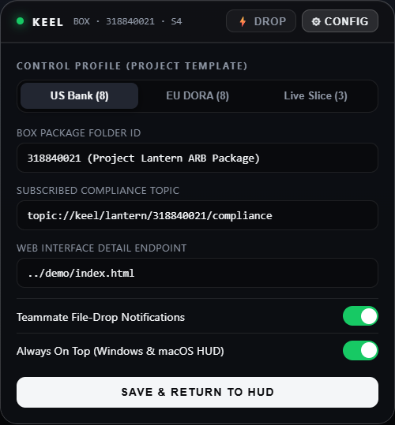
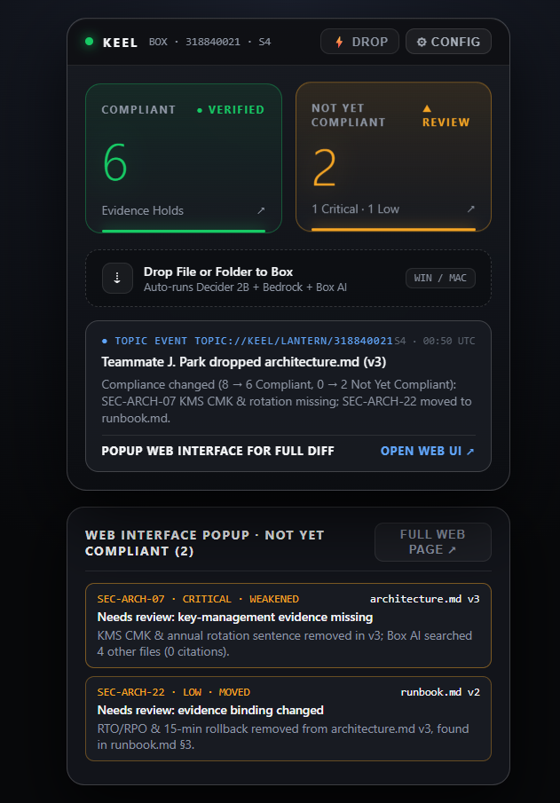

# KEEL · Tesla-Inspired Cross-Platform Desktop Client (Windows & macOS)

An ultra-clean, frameless, **draggable desktop compliance HUD** inspired by **Tesla OS / Tesla Energy HMI design**, engineered to run on both **Windows (`win32`)** and **macOS (`darwin`)**.

It connects a team's shared **Box Package Folder** (`318840021 · Project Lantern`) to the **AWS + Box AI** compliance evaluation pipeline (`Strands Decider 2B` input gate $\rightarrow$ `Bedrock Claude Sonnet 4.6` + `Box AI Ask` citation search $\rightarrow$ `Box Folder Metadata & Tasks`).

---

## Visual Walkthrough & Screenshots

### 1. Main Draggable Two-Box HUD (`6 Compliant` | `2 Not Yet Compliant`)

- **Left Green Telemetry Box (`COMPLIANT · ● VERIFIED`):** Displays the real-time count of controls whose evidence is verified and holds on the current Box folder snapshot (`6` on Snapshot `S4`), accented by a Tesla Energy green laser bar (`#17c964`).
- **Right Amber/Yellow Telemetry Box (`NOT YET COMPLIANT · ▲ REVIEW`):** Displays the count of controls needing review (`2` on Snapshot `S4`: `1 Critical · 1 Low`), accented by a Tesla warning amber laser bar (`#f5a524`).
- **Recessed File & Folder Drop Bay (`Drop File or Folder to Box`):** Drag and drop individual files or entire project folders from **Windows Explorer** or **macOS Finder** directly onto the widget.
- **Subscribed Topic Notification Info Box (`topic://keel/lantern/318840021`):** Live pub/sub feed alerting you when a teammate's file drop changes or satisfies compliance (`Teammate J. Park dropped architecture.md (v3)`).


---

### 2. Teammate File Drop Satisfies Compliance (`6 → 8 Compliant`, `2 → 0 Not Yet Compliant`)

When a teammate drops a remediated file (or when you click **`⚡ DROP`** / drop `architecture.md (v4 · CMK Restored)` onto the widget), the subscribed topic pushes a real-time notification and the two telemetry boxes update immediately:


---

### 3. Minimalist Tesla-Style Configuration Panel (`⚙ CONFIG`)

Clicking **`⚙ CONFIG`** in the top bar flips the rectangle into a clean **Tesla HMI Settings Sheet**:

- **Control Profile (Project Template) Segmented Pill Bar:** Switch between `US Bank (8)`, `EU DORA (8)`, and `Live Slice (3)`.
- **Box Package Folder ID:** Configure which Box folder the desktop client uploads to and monitors.
- **Subscribed Compliance Topic:** Configure the pub/sub topic channel (`topic://keel/lantern/318840021/compliance`).
- **Web Interface Detail Endpoint:** Target URL opened when clicking either box or the notification card.
- **Tesla Toggles:** Enable/disable `Teammate File-Drop Notifications` and `Always On Top (Windows & macOS HUD)`.



---

### 4. Popup Click for Web Interface Details

Clicking the **Left Green Box**, the **Right Yellow Box**, or the **Topic Notification Info Box** pops open the **Web Interface Detail Drawer** (and **`FULL WEB PAGE ↗`** launches the complete two-dimensional Web Interface at [`../demo/index.html`](../demo/index.html)):



---

## Architecture & File Structure

```text
desktop-client/
├── README.md                        # Documentation & Tesla HMI visual guide
├── widget.html                      # Tesla-inspired draggable 2-box HUD + Config + Popup UI
├── main.js                          # Electron main process (Windows & macOS frameless always-on-top window)
├── preload.js                       # Electron contextBridge IPC (topic pub/sub + Web UI popup launcher)
├── package.json                     # Cross-platform Electron manifest (win32, darwin, linux)
├── keel_desktop_client.py           # Zero-install Python Tkinter desktop widget + local HTTP/SSE topic broker
└── screenshots/
    ├── hud-main.png                 # Main 2-Box HUD (6 Compliant | 2 Not Yet Compliant)
    ├── hud-teammate-drop-satisfied.png # After teammate file drop satisfies compliance (8 | 0)
    ├── hud-config.png               # Tesla-style Configuration Panel
    └── hud-web-popup.png            # Popup Web Interface Detail Drawer
```

---

## Running on Windows & macOS

### Option A: Zero-Install HTML / Browser HUD Preview

Open [`desktop-client/widget.html`](widget.html) directly in any browser on Windows or macOS.

### Option B: Electron Native Frameless Desktop App (Windows & macOS)

```bash
cd desktop-client
npm install
npm start
```

### Option C: Zero-Dependency Python Native Widget + Local Topic Broker (Windows & macOS)

```bash
python desktop-client/keel_desktop_client.py
```
