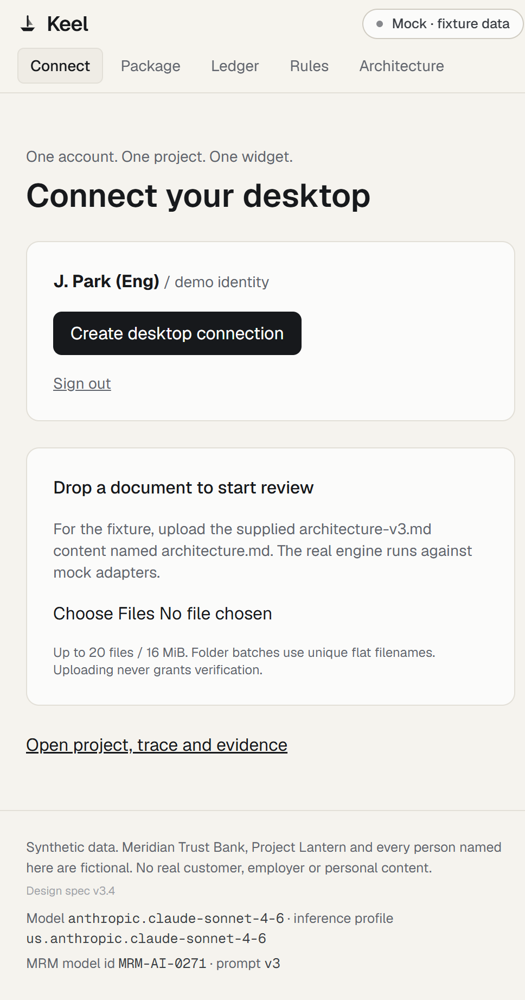

# Keel: consolidated demo release

**Sign in. Drop a file. Review the change. See the widget update.**

This branch combines the web/engine work from `feat/keel-app` and the lightweight
Tauri client from `feat/keel-native-widget`. It does not change `main`.

## Start the working demo

The default mode needs no Box or AWS credentials. It uses synthetic data and the
same deterministic engine as live mode, with clearly labelled mock adapters.

```text
cd app
npm ci
npm run build
npm start -- --hostname 127.0.0.1 --port 3100
```

Open **http://127.0.0.1:3100/connect**. Prefer the production build for a
presentation: rebuilding or hot-reloading a dev server during an active run can
interrupt an in-memory transaction.



1. Sign in as **Demo author**.
2. Install the desktop client; click **Create desktop connection**, then
   **Open this project in Keel** within 60 seconds.
3. Trust the loopback demo server on first use. The widget now reads the server's
   actual mock-engine state, not its own static preview. It must show **MOCK**.
4. Upload `architecture-v3.md` from the Lantern fixture **with the upload name
   `architecture.md`**. Use the connect page or drag a correctly named copy from
   Explorer/Finder onto the connected widget.
5. Open the package page to follow the evaluation and inspect the finding.
6. In the web app, sign out and sign in as **Demo reviewer**. The author session
   and its widget session are revoked on sign-out. For a two-person demonstration,
   use separate browser profiles or devices instead.
7. Review SEC-ARCH-22 and verify its runbook binding. SEC-ARCH-07 remains open.
   Return the latter to the author with a reason; do not pretend an upload
   itself made anything verified.

The scripted acceptance path is repeatable from another terminal:

```text
cd app
npm run test:demo
```

For an isolated check that starts and stops its own built server and temporary
fixture store, use `npm run test:release` after `npm run build`.

It is loopback- and mock-only. It resets the demo baseline, exercises separate
author/reviewer sessions, exchanges a one-time widget link, sends a real multipart
upload, waits for the engine, checks **8 -> 5 -> 6 verified**, proves the author
cannot approve, and validates the ledger chain and widget response shape.

## The shortest useful audit-readiness story

Pitch **security-review evidence continuity**, relevant to SOC 2 Security /
Availability readiness and an organization's ISO 27001 control program.
Do not claim that Keel issues a certificate or proves an entire framework.

| Demonstration item | What changed | What Keel does |
| --- | --- | --- |
| Key management, SEC-ARCH-07 | A reviewed customer-managed-key and rotation commitment disappeared | Shows the old/new evidence and required clauses; verification remains blocked |
| Recovery, SEC-ARCH-22 | Recovery wording left one document but remains in a runbook | Distinguishes changed evidence binding from lost support; a person can re-verify |
| Security logging, SEC-ARCH-17 | Reviewed support did not change | Holds the prior verification instead of creating unnecessary work |

These are the bank fixture's own control requirements, not verbatim ISO or AICPA
requirements. Annual key rotation is an example organizational requirement, not
a universal claim about either framework. A SOC 2 Type II report also requires
evidence of operation over a period; document review alone cannot establish that.

With one minute reserved for team and problem introduction, use the remaining
demo time on one changed clause, one surviving runbook quote and one human
decision. Keep installation, OAuth setup and upload preparation off stage.

## Identity and token separation

```text
User browser -- Box OAuth --> Keel server (HTTP-only session cookie)
User browser -- one-time code --> installed Keel widget
Widget -- project-scoped Keel bearer --> Keel server
Keel server -- user Box token --> upload under that user's folder access
Keel server -- service Box token + AWS credentials --> pinned review pipeline
Widget <-- authenticated projection of the engine's current outcomes
```

- Box tokens, the Box client secret and AWS credentials stay on the server.
- Live sign-in checks both Box folder access and the configured project
  author/reviewer allowlist.
- The client cannot select a different upload folder or another user's identity.
- Reviewer routes bind the action to the authenticated person, not a posted
  `as` value.
- No token is embedded in a finding URL. Desktop codes are single-use and expire
  in 60 seconds; session grants expire within an hour and are memory-only.
- Live human decisions occur in Box Tasks. Mock reviewer buttons simulate those
  responses through the same disposition handler.

## Switch to real Box and AWS

Use [app/.env.example](../app/.env.example) as the **names-only template** and
[the integration runbook](INTEGRATION.md) for Box scopes and the read-only gate.
Set values in the server's private environment or secret store, never in Git.

Required for a live end-to-end run:

1. A Box **OAuth app** for user sign-in, with the exact HTTPS callback URL.
2. A valid server developer token or an admin-authorized **CCG service account**
   with access to the project folder. OAuth and CCG may require separate apps.
3. The actual `BOX_FOLDER_ID` and named author/reviewer tenant identities.
4. An AWS credential chain with access to the configured Bedrock inference
   profile. A Box token does not supply AWS credentials.
5. `MOCK_MODE=false` and an HTTPS `KEEL_BASE_URL`; restart the server.

Then run the read-only gate and follow the seeding/write gates in
[INTEGRATION.md](INTEGRATION.md). A missing permission or credential is an
explicit error or skip, not a successful live run.

**Live boundary for this release:** the local machine had no safely configured
Box/AWS runtime credentials, folder ID or named tenant identities. The
read-only gate reported 17 skips. The integration code and mock transaction
are verified; actual Box OAuth, Box upload, Bedrock inference and tenant review
are not claimed as verified. Rotate any secret that was pasted into chat before
using it for a live service.

## Desktop installation and limits

See the [illustrated desktop README](../desktop-client/README.md).
The [installer workflow](../.github/workflows/desktop-build.yml) creates Windows
x64 and universal macOS artifacts. Local Windows ARM64 NSIS packaging is also
supported. Development packages are unsigned; macOS signing/notarization and
native acceptance require a Mac.

- Connected native drops accept up to 20 regular documents / 16 MiB per batch.
- Folders are flattened into this single demo project package; duplicate names,
  hidden files and symbolic links are rejected, not silently skipped.
- Mock mode accepts versions of the five existing fixture documents, not
  arbitrary AI analysis of uploaded content.
- A disconnected browser/widget preview never uploads or claims verification.
- The widget polls every three seconds; this is not a deployed topic broker.

## Deployment scope

Run **one persistent Node server** for the hackathon: sessions, one-time codes,
the upload lock and active executions are in memory; the ledger is a local JSON
file. Multiple instances, serverless background execution, refresh-token storage,
automatic retries of ambiguous uploads and production SSO lifecycle are outside
this release. Before public hosting, review the dependency audit, move sessions
and job ownership to shared storage, and complete tenant permission testing.

Windows checkout portability is handled by LF fixture attributes so version
hashes match the same documents on macOS. Versions unavailable in the local npm
mirror were replaced by available compatible releases and the lockfile rebuilt;
no install is claimed against unavailable packages.
