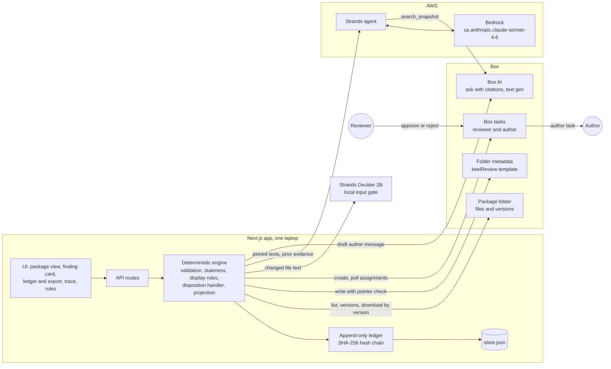

# Keel architecture

One page. Source of truth: spec v3.4, sections 3, 4 and 8 (`docs/research/30-design-v3.md`). Shapes: `app/src/lib/types.ts`.

## Components



In mock mode the Box, Bedrock, Box AI and Decider adapters are swapped for fixture-backed ones. The engine, ledger and store are the same code in both modes.

## Built and proposed

| Built on Saturday | Proposed, not built |
| --- | --- |
| Next.js app, mock mode by default, real mode on the integration laptop | Box webhook to a Lambda URL with signature verification |
| Snapshot and coverage from Box versions, SHA-256 manifest | EventBridge, SQS FIFO per folder |
| One Strands TypeScript agent on Bedrock, Zod-validated output, read tools only | The same agent on AgentCore Runtime with Observability |
| Box AI ask as `search_snapshot`, string-search fallback | AgentCore Identity for Box OAuth |
| Strands Decider 2B local input gate, omitted if absent | DynamoDB ledger with Streams to S3 Object Lock |
| Box AI text generation for the author task message | ServiceNow IRM for exceptions and evidence attachment |
| Deterministic engine and JSON ledger with hash chain | Jira for author work |
| Folder metadata, reviewer and author tasks, task polling | Box Automate calling Keel as its judgment step, untested |
| Package view, finding card, ledger with export, live trace | Batch shadow evaluation over historical package versions |

Disposition enforcement stays in the application layer in the proposed design too.

## One review transaction

```mermaid
sequenceDiagram
  autonumber
  participant Box as Box folder
  participant Eng as Engine
  participant Dec as Decider 2B
  participant Ag as Strands agent
  participant Br as Bedrock
  participant BAI as Box AI
  participant Led as Ledger
  participant Rev as Reviewer
  participant Au as Author

  Box->>Eng: new file version observed
  Eng->>Box: list items, download each file by version id
  Eng->>Led: snapshot_captured, texts_fetched with coverage
  Eng->>Dec: changed file text, two bounded questions
  Dec-->>Eng: injection yes or no, material or trivial or noise, with probabilities
  Eng->>Led: input_gate
  Eng->>Ag: controls, pinned texts, prior evidence, diff hints
  Ag->>BAI: search_snapshot, ask with citations over other files
  BAI-->>Ag: answer and cited passages
  Ag->>Br: one evaluation for the snapshot
  Br-->>Ag: per-clause support with quotes
  Ag-->>Eng: FindingSet, Zod-validated
  Eng->>Eng: validate quotes and citations, assess, classify, staleness by tier
  Eng->>Led: control_evaluated, verification_holds, binding_changed, acknowledgment events
  Eng->>Box: re-read snapshot pointer, write folder metadata
  Eng->>Box: create one review task per finding that needs review
  Rev->>Box: reject with reason, or approve with attestation phrase
  Eng->>Box: poll assignments
  Eng->>Eng: identity, author, binding and verify checks
  Eng->>BAI: draft author message
  Eng->>Box: create author task
  Box-->>Au: task quoting the lost clauses, due date
  Eng->>Led: human_disposition_recorded
  Eng->>Box: rewrite folder metadata
```

The disposition `returned_to_author` is recorded only after the author task exists. If that task cannot be created, the engine records an acknowledgment, writes no disposition, and the row keeps its Needs review label.

## Trust boundaries

- **The model proposes.** It returns per-clause support, quotes, basis and a suggested action. Its schema has no disposition field and no history field, and unknown control ids are rejected.
- **Code validates and owns state.** Code derives the machine assessment from clause support and applies precedence. Code applies staleness, materiality and the sixteen display rules.
- **Only the human handler writes a disposition.** It checks that the responder is a configured reviewer, is not the author of the evidencing file, and is acting on the current binding. `verified` also needs every clause supported, no contradiction, and the attestation phrase.
- **Reads are constrained to the snapshot.** Read tools reject any file or version outside the pinned manifest. Box AI results are not relied on for a file whose current version differs from the pinned one.
- **Citations are validated against pinned text.** Every quote and every Box AI citation must string-match the pinned version text. An unvalidated citation counts as no evidence.
- **Document text is data.** Decider gates each changed file before Bedrock sees it. A quarantined file makes its dependent controls `not_evaluated` with reason `input_gate`.
- **Box metadata is a projection.** The write happens only if the current snapshot pointer still matches. Consumers must compare `keel_snapshot_id` with Keel's current snapshot before trusting a status field.

## Ledger event envelope

Every event carries the same envelope. Fields that do not apply are `null`. Code is in `app/src/lib/engine/ledger.ts`.

| Field | Meaning |
| --- | --- |
| `event_id` | `EVT-NNNN`, sequential |
| `ts` | UTC observation time, second precision |
| `phase` | `seed`, `live_v3`, `live` or `replay` |
| `snapshot_id`, `control_id`, `event_type` | What the event is about |
| `machine_assessment`, `prior_machine_assessment`, `change_classification` | Machine fields |
| `actor` | Type `human`, `app`, `agent`, `gate` or `boxai`, with name and role |
| `fileId`, `fileName`, `versionId`, `contentHash` | The evidence binding |
| `quote`, `basis`, `clause_support` | The evidence |
| `prompt_hash`, `mrm_model_id`, `normalization` | Model governance and the disclosed normalization |
| `projection` | Box write result: `n/a`, `ok`, `failed`, `deferred` or `ambiguous` |
| `box_deep_link` | Link to the file version, or the folder |
| `chain_hash` | Hash chain link |

Machine events about a control also carry `current_disposition` and a `prior_verification` block. They never carry `human_disposition`, and the append function throws if one tries. Only `human_disposition_recorded` events from a human actor carry it. Type-specific fields such as `coverage`, `model_id`, `inference_profile`, `prompt_version`, `error` and `acknowledgment` follow the envelope.

### Hash chain

```
genesis       = "0" * 64
chain_hash[i] = sha256( chain_hash[i-1] + canonicalJSON(event[i] without chain_hash) )
```

Canonical JSON matches Python `json.dumps(obj, sort_keys=True)` with default separators and `ensure_ascii=True` escaping. The fixture generator chained the seed ledger that way, so the app verifies all 98 events of `demo-data/lantern/ledger.json` and appends live events to the same chain. The export manifest carries the chain head and a hash over the exported events.

The chain shows tampering inside a copy of the ledger. It is not independent integrity protection, because whoever holds the file can rebuild the chain. The export screen says so. S3 Object Lock is the proposed control.
