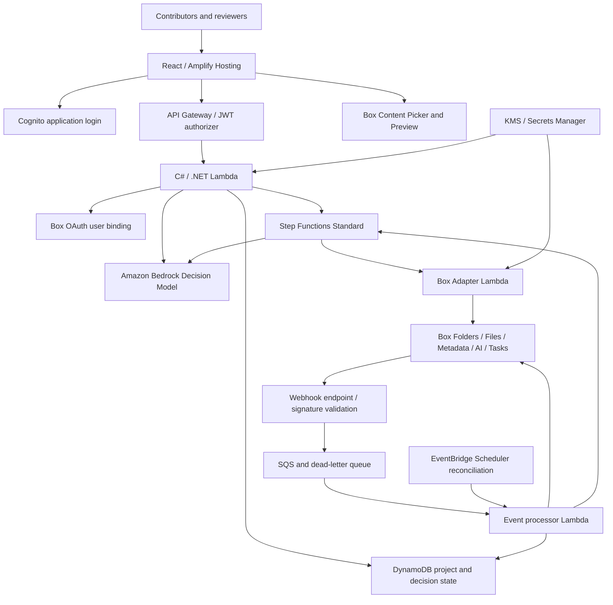

# Architecture and API Breakdown

> **Superseded.** This document describes idea #2 (EpistemicBox / agreement drift). The current
> build is Keel's folder checks; see [`v1-local-design.md`](v1-local-design.md) and
> [`../keel/README.md`](../keel/README.md).

Status: proposed design, not implemented or tenant-validated.

## 1. Design principle

Use Box's existing content, metadata, AI and collaboration capabilities, and
AWS managed services for the application control plane and intake decisioning.
Custom code focuses on folder-to-template triage via Amazon Bedrock, Project
Template composition, change modeling, controlled reviewer routing and
version-bound baseline promotion.



No ECS service, vector database or OpenSearch cluster is required for the MVP.

## 2. Service ownership

| Concern | Box | AWS / application |
| --- | --- | --- |
| Folders, files and versions | Source folders, documents and review packets | Folder inventory, version manifests and hashes |
| Folder triage & template suggestion | Folder item listing and document text previews | Amazon Bedrock decision model (Project Template + Type 1/Type 2 classification) |
| Template authoring | Box Extract and Metadata Templates | Template bundle registry |
| Structured extraction | Box AI extraction API | Scheduling and result validation |
| Semantic explanation | Box AI Ask with citations | Change cards and evidence checks |
| Review | Tasks and actual human decisions | Policy-based routing and orchestration |
| Identity | Box OAuth and Box user identity | Cognito sessions and project membership |
| Events | Webhooks | Validation, queues and reconciliation |
| Accepted baseline | Referenced Box snapshots | Conditional promotion and decision history |

## 3. Identity and content authorization

Cognito authenticates the application session. Box OAuth separately links the
user to a Box user ID. Verify the link with `GET /users/me`; do not infer the
same person from an unverified email string.

Keep project roles and Box access separate. A Reviewer application role does not
grant access to a Box file; Box access does not make someone an authorized
project approver. Reviewer assignments come from controlled role mappings.

Use user-authorized access for user content operations and approvals. Do not use
one broad service account to impersonate all reviewers. Background processing
must have explicitly authorized access to the exact project content.

Keep application secrets in Secrets Manager with KMS protection. Store user
OAuth token material only in a deliberately designed encrypted server-side
store with restricted IAM, rotation/refresh handling and no token logging.
Use OAuth state and the current Box-recommended security controls.
Never expose reusable privileged tokens to the frontend.

## 4. Project Template registry

Store immutable application-level revisions of:

```text
ProjectTemplateRevision
  id, revision
  document_roles
  required_and_optional_templates
  box_template_scope_and_key_references
  captured_template_schema_hashes
  extraction_configuration_revision
  comparison_policy_revision
  approval_policy_revision
```

Box Extract supports AI-assisted template creation from up to ten reference
files in its Custom Extract Agent builder, subject to administrator privileges,
premium model availability and AI unit consumption. Use that native setup
experience rather than assuming an undocumented schema-generation endpoint.

The template bundle is our application object, not an assumed Box-native group.
Apply only relevant templates to each document role.

If a template changes, preserve its captured schema/configuration. Compare
proposal revisions under the same review standard, or explicitly re-extract
both under a new standard. A newly introduced review field is a change in
review criteria, not evidence that the author changed the proposal.

## 5. Folder intake, Amazon decision model and revision snapshots

Use Box Content Picker to select an existing **Box folder** (or upload a folder
of documents) and Box Preview for viewing individual files. Check component
compatibility and token scopes before committing to the UI.

For new content, use Box folder and upload APIs (`POST /folders`,
`GET /folders/{folder_id}/items`, and `POST https://upload.box.com/api/2.0/files/content`).
Large files must not pass wholesale through API Gateway/Lambda. Validate the
supported client upload or chunked-upload pattern and use appropriately scoped
authorization; do not assume the browser can safely receive a server token.

### Project Template suggestion with Amazon's decision model

When a project owner uploads or selects a folder of documents, AWS runs an
intake triage step using **Amazon Bedrock** (`Converse` API with structured
tool/schema output, such as Amazon Nova Pro or Claude on Bedrock):

1. **Inspect folder inventory and bounded excerpts:** Lambda lists the folder's
   files (`GET /folders/{folder_id}/items`) and retrieves filenames, metadata,
   and bounded text excerpts or Box AI summaries for the files the user is
   authorized to read.
2. **Evaluate against registered Project Templates and Amazon's decision model:**
   Bedrock compares the folder against the organization's registered
   `ProjectTemplateRevision` catalog and classifies the proposal under Amazon's
   **Type 1 (One-Way Door: irreversible, high-consequence)** vs. **Type 2
   (Two-Way Door: reversible, bounded pilot)** decision model.
3. **Return a structured recommendation:**
   - `recommended_project_template_id` and `revision` (for example,
     `EnterpriseAI/v1` vs. `VendorOnboarding/v1`).
   - `decision_tier`: `TYPE_1_ONE_WAY_DOOR` or `TYPE_2_TWO_WAY_DOOR`, with
     cited reasons from the folder documents.
   - `file_role_mappings`: maps each file in the Box folder to a document role
     in the Project Template (`Proposal.docx -> BusinessCase`,
     `Architecture.pdf -> Architecture`, `DPIA.docx -> Privacy`,
     `Budget.xlsx -> Finance`), determining which Box Metadata Template in the
     bundle will extract from which file.
   - `missing_required_roles`: highlights any required document role missing from
     the uploaded folder before downstream review starts.
4. **Human confirmation and revision consistency:**
   - The project owner confirms or edits the suggested Project Template and
     file-role mapping in Idea Hub.
   - For a subsequent folder upload (V2+), comparison still binds to the
     approved baseline's template revision by default. If the Amazon decision
     model detects that the new folder crosses from a **Type 2 pilot** into a
     **Type 1 production commitment** (for example, introducing cross-border
     data transfer or external customer data), it flags a **Decision Tier
     Escalation (`Type 2 -> Type 1`)** and proposes the stricter template/review
     requirements for human confirmation.
   - Bedrock's recommendation is advisory: it selects only from registered
     templates and cannot bypass deterministic policy rules or silently downgrade
     a Type 1 requirement.

Every confirmed folder submission creates a multi-document manifest:

```text
ProposalRevision R3
  source_folder_id: folder 99812
  template_revision: EnterpriseAI/v1
  decision_tier: TYPE_1_ONE_WAY_DOOR
  documents:
    BusinessCase: file A / version 4 / content hash
    Architecture: file B / version 2 / content hash
    Privacy: file C / version 3 / content hash
    Finance: file D / version 2 / content hash
```

The approved baseline points to this manifest, not to mutable "latest" files.
For AI input, use separately addressable Box snapshot files for the pinned
versions. Do not assume AI APIs accept a historical version selector.
Preserve access restrictions on derived snapshots, extracts and change cards.
Revalidate hashes before promotion; snapshot naming alone is not immutability.

Record source timestamps separately from upload/observation timestamps.
Two uploaded documents do not reveal when the author actually edited a sentence.

## 6. Extraction and comparison

Step Functions Map states invoke bounded parallel extraction through Lambda.
Respect Box limits, retry transient errors with backoff, and surface failures.

1. Call `POST /ai/extract_structured` for each relevant file/template.
2. Supply `metadata_template` or explicit `fields`, not both.
3. Validate types, missing values and available references.
4. Preserve raw extraction provenance separately from confirmed business values.
5. Compare numbers, dates and enums deterministically in Lambda.
6. Call `POST /ai/ask` with baseline/candidate snapshots and
   `include_citations: true` for semantic explanations and idea-evolution
   classification.
7. Classify each finding into an explicit **Idea Evolution State** for the visual
   history graph:
   - **`ADDED` (`+ Added`):** A new sub-idea, capability, dependency or commitment
     not present in the baseline.
   - **`PIVOTED` (`↻ Pivoted`):** An existing commitment or design choice whose
     direction, scope or value materially changed (`before -> after`).
   - **`REMOVED` (`− Removed`):** A previously approved constraint, safeguard or
     scope item that was dropped or scoped out.
   - **`RETAINED` (`✓ Retained`):** Core commitments unchanged from the baseline.
   - **`HARMLESS_REWORDING`:** Wording-only edits that do not alter meaning or
     trigger business approval.
8. Validate response shape, evidence and source/version bindings.
9. Show unsupported findings as Unverified; never invent a quote or location.

An extraction response is not a metadata write. Persist selected fields through
the metadata instance APIs when useful. Box metadata is file-level; use the
application store for individual changes, task mappings and decision events.

The MVP shows old/new excerpts, section labels and preview links. AI citations
alone do not guarantee pixel-level highlighting across arbitrary document layouts.

AI content and document text are untrusted input. They cannot supply executable
workflow definitions, privileged tool instructions or arbitrary approval recipients.

## 7. Review orchestration

The application proposes a review plan under explicit, versioned policies:

| Change | Required role |
| --- | --- |
| Data region, retention, sensitive-data use | Privacy / Security |
| Cost over a configured threshold | Finance |
| Scope or acceptance criteria | Product Owner |

A human confirms the change set and review plan before task creation.
Create a separate Review Packet in Box containing the manifest, baseline,
evidence, change-set hash, policy revision and required reviewers.

Create Box tasks with `action=review` and, where appropriate,
`completion_rule=all_assignees`; create assignments separately.
Reviewers use their own Box identities to approve/reject in the native UI.
Do not automatically expand file access to make an assignment work.

Step Functions Standard owns the business state machine:

```text
Submitted -> Extracting -> Comparing -> AwaitingConfirmation
          -> AwaitingReview -> Approved -> BaselinePromoted
                           -> Rejected
                           -> Superseded
                           -> Expired
```

Processing failures remain explicit and retryable, never successful approvals.
A newly submitted candidate supersedes an in-flight candidate for the MVP.
A late approval cannot promote a superseded submission. Rejections never replace
the accepted baseline. If a baseline changes concurrently, require re-comparison.

Use Box Relay only for an existing, preconfigured manual workflow when enabled
and authorized. Choose one business orchestrator per route; do not maintain
conflicting Relay and Step Functions state machines. Public Relay APIs are not
assumed to create arbitrary new workflow definitions.

## 8. Webhooks and reconciliation

Register supported triggers such as `TASK_ASSIGNMENT.UPDATED` and relevant
folder/file events. Uploads made through Idea Hub start processing after the
successful manifest registration; do not depend solely on webhook timing.

Verify Box webhook signatures and freshness before queueing an event.
Use SQS with a dead-letter queue, deduplication keys and idempotent consumers.
Re-read Box task/assignment state rather than trusting notification payloads.
Recheck source and review-packet validity before advancing a workflow.

EventBridge Scheduler periodically reconciles pending tasks and source validity
to compensate for lost notifications. Verify actual new-version event behavior
in the tenant instead of assuming all upload paths behave identically.

Keep Step Functions callback tokens server-side. Never put them in Box
comments, review packets or browser URLs. Authenticate and authorize any
callback-triggering request before invoking AWS completion APIs.

## 9. Decision ledger and baseline promotion

Suggested DynamoDB entities:

| Entity | Purpose |
| --- | --- |
| Project | Membership and Box references |
| ProjectTemplateRevision | Captured review standard |
| ProposalRevision | Exact multi-document manifest |
| ChangeSet | Findings, evidence and human confirmations |
| ReviewRequest | Tasks, assignments and manifest binding |
| DecisionEvent | Actor, decision, reason and timestamps |
| ApprovedBaseline | Current accepted revision |

Record file/version IDs, content hashes, template/prompt/policy revisions,
change-set hash, actual reviewer Box IDs and task IDs.

Use conditional writes/transactions to promote only when:

- Every required assignment has an authoritative approved state.
- The candidate is still eligible and not superseded.
- Source snapshots and the review packet match their bound hashes.
- The baseline still matches the one used for comparison.

External Box calls are not atomic with DynamoDB. Reserve a logical operation
before creating tasks, serialize work per review request, and persist returned
IDs. An ambiguous timeout requires reconciliation before another creation
attempt; do not promise exactly-once behavior across the two services.
If exact external task creation cannot be reconciled, flag it for review.

Keep decision history and append corrective events instead of rewriting prior
decisions. A normal DynamoDB table plus Box files is auditable, not automatically
tamper-proof. S3 Object Lock and independent audit controls are optional later
work. CloudTrail records AWS activity, not the complete business approval record.

## 10. Approved context interface

An application endpoint resolves and returns only an authorized, exact approved
revision and its provenance. It never substitutes the latest draft.

This governs our endpoint, not every Box client. Users and agents independently
authorized to access drafts can bypass this interface.

## 11. API inventory

Box paths below use `https://api.box.com/2.0` unless an upload URL is shown.
Validate each request schema, entitlement, pagination and scope during setup.

| Capability | Endpoint |
| --- | --- |
| OAuth token exchange/refresh | `POST https://api.box.com/oauth2/token` |
| Current user | `GET /users/me` |
| Create folder | `POST /folders` |
| List folder items | `GET /folders/{folder_id}/items` |
| Folder collaborators | `GET /folders/{folder_id}/collaborations` |
| Enterprise templates | `GET /metadata_templates/enterprise` |
| Template schema | `GET /metadata_templates/{scope}/{template_key}/schema` |
| Create template | `POST /metadata_templates/schema` |
| Upload file | `POST https://upload.box.com/api/2.0/files/content` |
| Upload version | `POST https://upload.box.com/api/2.0/files/{file_id}/content` |
| File/current version information | `GET /files/{file_id}` |
| Historical versions | `GET /files/{file_id}/versions` |
| Pinned content | `GET /files/{file_id}/content?version={version_id}` |
| Structured extraction | `POST /ai/extract_structured` |
| Cited semantic analysis | `POST /ai/ask` |
| Add metadata instance | `POST /files/{file_id}/metadata/{scope}/{template_key}` |
| Update metadata instance | `PUT /files/{file_id}/metadata/{scope}/{template_key}` |
| Create review task | `POST /tasks` |
| Assign reviewer | `POST /task_assignments` |
| Read task | `GET /tasks/{task_id}` |
| Read assignments | `GET /tasks/{task_id}/assignments` |
| Optional user-authorized decision | `PUT /task_assignments/{assignment_id}` |
| Optional discussion comment | `POST /comments` |
| Register webhook | `POST /webhooks` |
| Optional list Relay workflows | `GET /workflows` |
| Optional start manual Relay flow | `POST /workflows/{workflow_id}/start` |

AWS managed capabilities:

| Service | Usage |
| --- | --- |
| Amplify Hosting | React delivery |
| Cognito | Application authentication |
| API Gateway | API routing and JWT authorization |
| Lambda / .NET | Application, Bedrock triage and Box adapters |
| Amazon Bedrock (`Converse` API) | Folder-to-Project-Template recommendation, file-to-role mapping and Type 1 / Type 2 decision-tier classification |
| Step Functions Standard | `StartExecution`, controlled callbacks and timeouts |
| DynamoDB | Conditional writes and transactions |
| SQS | Queues, retries and dead-letter handling |
| EventBridge Scheduler | Reconciliation |
| Secrets Manager / KMS | Secret and encryption management |
| CloudWatch / CloudTrail | Operational visibility and AWS activity |

Amazon Bedrock and Box AI have distinct, non-duplicated roles:
- **Amazon Bedrock** operates at **folder intake and decision framing**: it
  evaluates a newly uploaded folder of documents, suggests which Project
  Template bundle applies, classifies the proposal under Amazon's Type 1
  (One-Way Door) vs. Type 2 (Two-Way Door) decision model, maps folder files to
  document roles, and flags missing artifacts or tier escalations.
- **Box AI** operates at **template-bound content extraction and cited diffing**:
  `POST /ai/extract_structured` extracts fields per Box Metadata Template, and
  `POST /ai/ask` explains semantic changes with source citations.

## 12. Public documentation and verification limits

Primary sources consulted for this proposal:

- [AI-generated templates in Box Extract](https://support.box.com/hc/en-us/articles/51960947352979-Metadata-template-creation-and-AI-generated-metadata-templates-in-Box-Extract)
- [Structured extraction](https://developer.box.com/guides/box-ai/ai-tutorials/extract-metadata-structured)
- [Box AI questions and citations](https://developer.box.com/guides/box-ai/ai-tutorials/ask-questions)
- [Box Tasks](https://developer.box.com/guides/tasks/)
- [Task creation](https://developer.box.com/guides/tasks/create/)
- [Task assignments](https://developer.box.com/reference/post-task-assignments/)
- [Webhook triggers](https://developer.box.com/guides/webhooks/triggers/)
- [File versions](https://developer.box.com/reference/get-files-id-versions/)
- [Box Relay](https://developer.box.com/guides/box-relay/)
- [AWS Step Functions integration patterns](https://docs.aws.amazon.com/step-functions/latest/dg/connect-to-resource.html)

Reading public documentation is not a tenant integration test. No infrastructure,
real approvals, runtime performance or API acceptance has been demonstrated yet.
