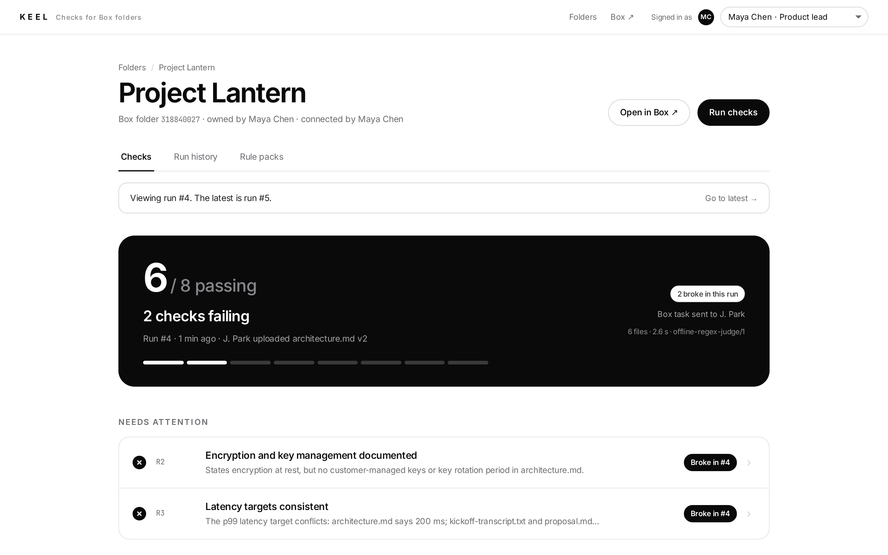
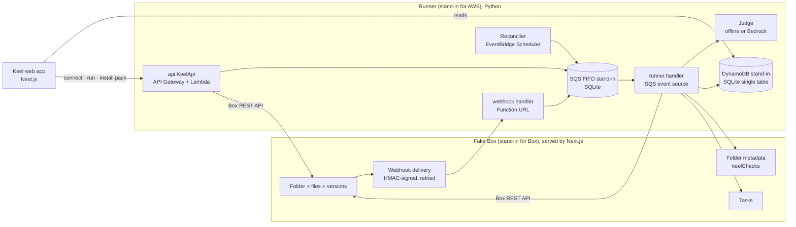

# Keel: checks for Box folders (local v1)

Keel works like CI for documents. A project folder in Box contains a `keel-rules.md` file with plain-language rules. Every upload to the folder reruns those rules. Each rule passes or fails, and every result shows the quotes it is based on. When a change breaks a check, Keel creates a Box task for the person who uploaded that version.

This first version runs entirely on one machine. **Fake Box** stands in for Box, and SQLite-backed stand-ins replace Lambda, SQS FIFO and DynamoDB. Each stand-in behaves no more permissively than the real service, so later we can swap them for real adapters without changing how the product behaves. See [`../docs/v1-local-design.md`](../docs/v1-local-design.md) for details.



## Demo videos

| Video | What it shows |
| --- | --- |
| [`keel-walkthrough.mp4`](demo/videos/keel-walkthrough.mp4) | The full walkthrough (~2 min) |
| [`01-connect-first-run.mp4`](demo/videos/01-connect-first-run.mp4) | Connect a Box folder. Run #1 reads every file and finds 6 of 8 checks passing, with reasons and a Box task for the owner. |
| [`02-uploads-rerun-checks.mp4`](demo/videos/02-uploads-rerun-checks.mp4) | J. Park uploads a file and Dana edits the checklist in Box. Each upload reruns the checks. The folder ends at 8 of 8, and the Box metadata reads **Passing**. |
| [`03-regression-blame-notify.mp4`](demo/videos/03-regression-blame-notify.mp4) | A "for clarity" rewrite of the architecture doc breaks two checks: a latency conflict with the meeting transcript, and lost key-management statements. Both are traced to J. Park's upload, and he gets one Box task. |
| [`04-rule-packs.mp4`](demo/videos/04-rule-packs.mp4) | Installing the GDPR design-review pack adds `uses:` to `keel-rules.md`, which triggers a run. Five new checks appear, two of them failing. |
| [`05-run-history.mp4`](demo/videos/05-run-history.mp4) | Run history: every upload, what it broke or fixed, and when the rules changed. |

## Run it

Requirements: Node 20+ and Python 3.11+. The local stack uses only the Python standard library.

```bash
cd keel
./dev.sh --seed            # starts both servers, then seeds the "Project Lantern" folder in Fake Box
# Keel      http://localhost:3000
# Fake Box  http://localhost:3000/box
```

- `./dev.sh --seed-connected` also connects the folder to Keel, so run #1 happens right away.
- `./dev.sh --prod` builds the app and runs `next start`. It is smoother for demos.

Try the flow by hand:

1. In Keel (`/`), click **Connect** on *Project Lantern*. Run #1 shows 6 of 8 checks passing.
2. In Fake Box, switch to **J. Park**. Upload `content/lantern/2-fix/data-retention.md`. Keel reruns and shows 7 of 8.
3. Switch to **Dana Okafor**. Edit `security-checklist.md` in Fake Box and tick the open item. Keel shows 8 of 8.
4. Switch to **J. Park**. Upload `content/lantern/3-regression/architecture.md`. R2 and R3 break, and J. Park gets a Box task.
5. In Keel, open **Rule packs** and install *GDPR design review*. Five more checks appear.
6. Upload `content/lantern/4-repair/architecture.md` to fix R2 and R3.

## How it works



Each run follows these steps:

1. **Snapshot.** List the folder and record each file's version ID, SHA-1 and uploader. If nothing changed since the last run, the run is skipped. This also absorbs duplicate webhook deliveries.
2. **Rules.** Parse `keel-rules.md` and resolve each `uses: pack@version` line from the pack catalog.
3. **Read.** Download every text file at its exact version.
4. **Judge.** Give every rule a pass/fail verdict with a reason and citations.
5. **Validate.** Every quoted passage must appear in the exact file version it cites. If it doesn't, the rule shows **Couldn't evaluate**. It never shows a pass.
6. **Compare** with the previous run: which rules broke, which were fixed, and which are new.
7. **Blame.** A newly failing rule is attributed to the uploader of the changed file it cites.
8. **Notify.** Create one Box task per person who broke something, attached to the file they changed. Failures nobody caused (a first run or new rules) go to the folder owner. When a reported rule passes again, the existing task's message is updated.
9. **Project.** Write the status and pass/fail counts to the folder's `keelChecks` metadata in Box.

### Local stand-ins and what they replace

| Production | Local v1 | Code |
| --- | --- | --- |
| Box REST API (`api.box.com/2.0`, `upload.box.com`) | Fake Box HTTP API under `/fakebox/api/2.0` and `/fakebox/upload/2.0` | `web/lib/fakebox/core.ts`, `web/app/fakebox/**` |
| Box web app | Fake Box UI at `/box` (folders, versions, edit, tasks, metadata, webhook log) | `web/app/box/**` |
| Box webhooks v2 | Signed deliveries from Fake Box: HMAC-SHA256 over body + timestamp, primary and secondary keys, 5 retries | `core.ts → deliver()` |
| Lambda behind a Function URL | `keel_runner.webhook.handler(event, context)` | `runner/keel_runner/webhook.py` |
| SQS FIFO queue | SQLite queue: group ID required, one message in flight per group, 5-minute dedup, 1 MiB limit | `runner/keel_runner/queue.py` |
| Lambda with an SQS event source | `keel_runner.runner.handler`, which returns `batchItemFailures` | `runner/keel_runner/runner.py` |
| DynamoDB single table | SQLite `items(pk, sk)`: key lookups and prefix queries only, 400 KB items, 100-item transactions | `runner/keel_runner/store.py` |
| API Gateway + Lambda | Local HTTP API on `:8787` | `runner/keel_runner/api.py`, `local.py` |
| EventBridge Scheduler | Reconciler thread that queues a check every `KEEL_RECONCILE_SECONDS` | `local.py` |
| Amazon Bedrock (Strands agent) | `KEEL_JUDGE=offline` (regex hints) or `KEEL_JUDGE=bedrock` | `runner/keel_runner/judges/` |
| Box sign-in | "Signed in as" user switcher (cookie) | `web/lib/session.ts` |

## Rules and rule packs

`keel-rules.md` lives in the Box folder:

```markdown
# Keel rules — Project Lantern
uses: gdpr-design-review@1.0.0

## R3 · Latency targets consistent
p99 latency targets agree across every document and meeting transcript in the folder.
```

- Each `## <id> · <title>` heading starts a rule, and the text under it is the rule.
- A `uses:` line pins a pack version from `packs/<id>/<version>.md`. Pack rule IDs are namespaced, for example `gdpr-design-review/G3`.
- Included packs:
  - *GDPR design review*
  - *NIST CSF 2.0 design slice*
  - *OWASP ASVS L1 architecture*
  - *Meridian ARB checklist*: an org-private pack.
  - An *ISO/IEC 27001* card that is deliberately locked. The ISO text is copyrighted, so the organisation would have to supply its own licensed text.
- A passing pack means the documents state what the standard asks for, consistently. It is **not a certification**.

## Judges

- **`offline` (default).** Deterministic and needs no network access. It is a stand-in for UX iteration and tests.
  - It reads per-rule hints: inline `<!-- keel:offline {...} -->` comments in pack files, and `content/offline-hints.json` keyed by rule title for folder rules.
  - Supported checks: `require_all` (each clause must be found somewhere), `consistency` (all extracted values must agree) and `checklist_complete`.
  - A rule without a hint shows **Couldn't evaluate**.
- **`bedrock`.** A Strands agent on Amazon Bedrock (`us.anthropic.claude-sonnet-4-6` by default) with structured output and no tools.
  - It reads the plain-language rule text, so any rule works.
  - To use it, run `pip install -r runner/requirements-bedrock.txt`, set `KEEL_JUDGE=bedrock`, and provide AWS credentials with `bedrock:InvokeModel`.
  - It has **not been run against Bedrock yet**. It is covered by unit tests on its prompt and output mapping only.

## Tests

```bash
cd keel/runner && python3 -m unittest discover -s tests -t .   # judge, rules, validation, runner story, queue, store, signatures
cd keel/web && npx eslint . && npx next build
```

## Re-recording the videos

```bash
cd keel && ./dev.sh --prod &                 # stack must be running
cd demo && npm install && npx playwright install chromium
npm run record     # reseeds the folder, records, cuts chapters (needs ffmpeg for MP4)
npm run screens    # README screenshots
```

## Layout

```
keel/
  dev.sh                 start everything
  .env.example           shared configuration (web + runner)
  content/lantern/       demo documents: 1-initial, 2-fix, 3-regression, 4-repair
  content/offline-hints.json
  packs/                 rule pack catalog (<id>/<version>.md)
  runner/keel_runner/    Python: webhook, queue, store, runner, judges, api, local server, seed
  runner/tests/          unit tests
  web/                   Next.js: Keel UI, Fake Box API + UI
  demo/                  Playwright recording + screenshots + videos
```

## Known limits of v1

- **Files.** Only text files (`.md`, `.txt`, `.csv`, `.json`, `.yaml`, `.vtt`) are read. Other types are listed as "unsupported" in the run's coverage. In production, Box's `extracted_text` representation would cover PDF and DOCX.
- **No real authentication.**
  - The acting user is a dev switcher.
  - The runner uses one Fake Box service token with `As-User` for pack installs.
- **Webhook addresses.** Fake Box delivers webhooks over plain HTTP to localhost. Real Box requires a public HTTPS endpoint on port 443.
- **Bedrock judge not exercised.** The Bedrock path has not been run end to end. The demo uses the offline judge, which only understands rules that have hints.
