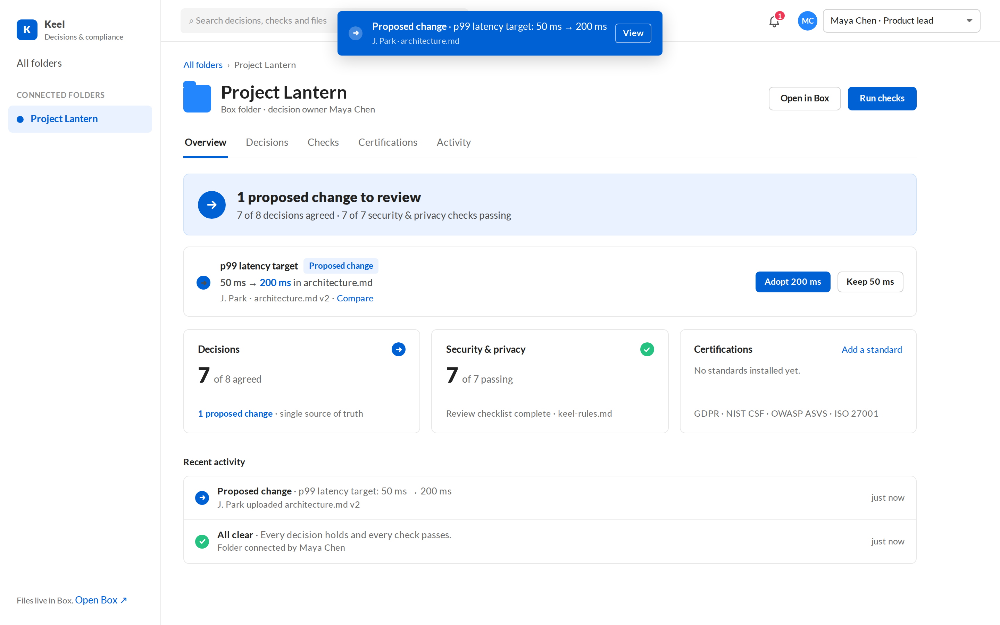
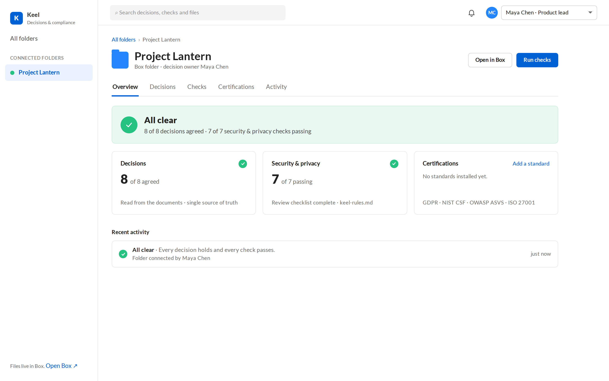
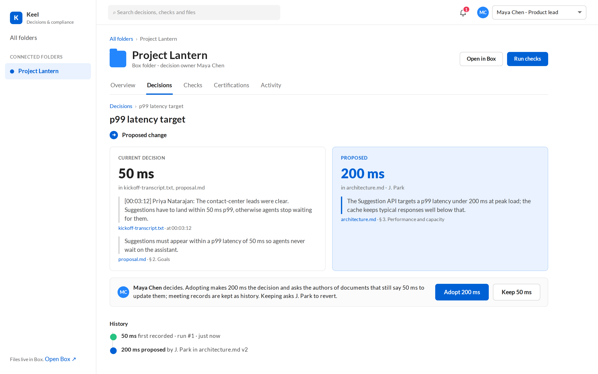
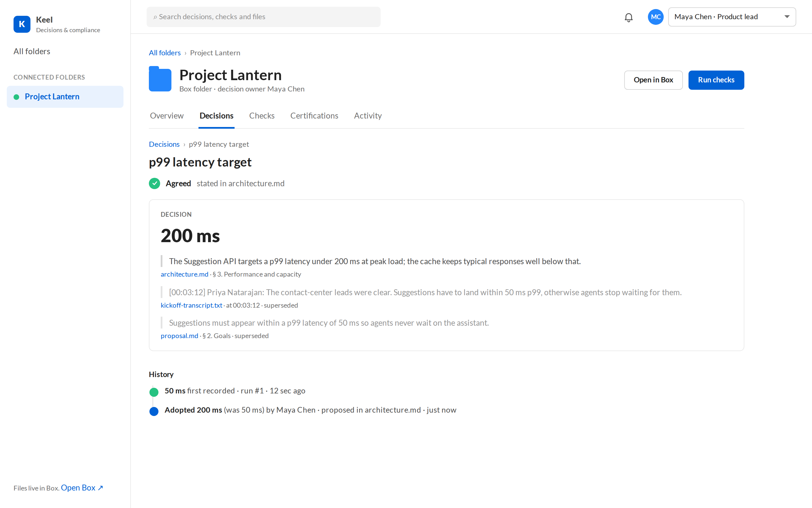
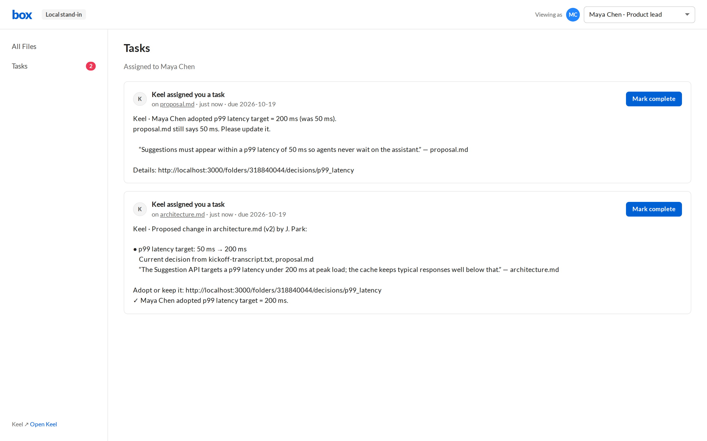
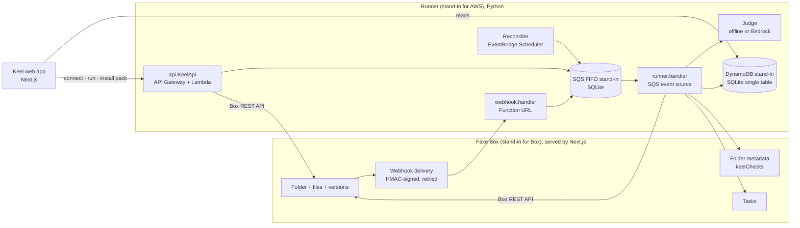

# Keel: decisions and compliance for Box folders

Keel gives a Box project folder **one source of truth for its decisions** and **checks its compliance on every upload**.

- **Decisions.** Keel reads every document in the folder: proposals, architecture docs, checklists and meeting transcripts. It extracts what the team has decided, for example "p99 latency 50 ms", "data stays in the EU" or "keys are customer-managed, rotated every 12 months". Nobody maintains a list by hand.
  - **Proposed change.** When a new upload says something different, Keel doesn't block it. It shows the current decision and the proposed value side by side, quoted from the exact file versions.
  - **Adopt.** The decision owner adopts the change with one click. The older statements are kept as superseded history: a meeting transcript stays a record of what was said. Authors of documents that should stay current get a Box task to update them.
  - **Keep.** The author gets a Box task to revert.
  - **Changes are welcome; silent changes are not.**
- **Compliance.**
  - **Security & privacy.** Plain-language rules in `keel-rules.md` are checked on every upload.
  - **Certifications.** Standards such as GDPR, NIST CSF, OWASP ASVS and an internal ARB checklist install as versioned rule packs.
- **Productivity.** Nobody rereads the folder. Only the person whose upload caused a problem gets a Box task. The audit trail records who changed what, and what it did.

The UI follows Box's design language (Lato, Box blue, compact lists and cards). Colour carries meaning only:

- **Green:** the decision is agreed or the check passes.
- **Blue:** a proposed change waits for a decision.
- **Red:** a compliance check fails.



## Demo videos

| Video | What it shows |
| --- | --- |
| [`keel-demo.mp4`](demo/videos/keel-demo.mp4) (~50 s) | **All clear** → J. Park uploads a rewrite in Box → **Proposed change** notification: p99 latency 50 ms → 200 ms → compare both sides → Maya **adopts 200 ms** → decision updated, old statements superseded, the proposal's author gets a Box task to update it → **all clear**, with the change on record. |
| [`keel-keep.mp4`](demo/videos/keel-keep.mp4) (~25 s) | The same change, but Maya **keeps 50 ms**. J. Park gets a Box task to revert, uploads the fix, and Keel shows **Back in agreement**. |
| [`keel-certifications.mp4`](demo/videos/keel-certifications.mp4) (~25 s) | Install the GDPR pack → 4 of 5 (no DPIA) → Privacy uploads the DPIA summary → **GDPR ready**. |

| | |
| --- | --- |
|  |  |
|  |  |

## Run it

Requirements: Node 20+ and Python 3.11+. The local stack uses only the Python standard library.

```bash
cd keel
./dev.sh --seed-connected   # starts everything and seeds "Project Lantern" connected, so it starts all green
# Keel      http://localhost:3000
# Fake Box  http://localhost:3000/box
```

Try it:

1. In Fake Box (`/box`), switch to **J. Park** and upload `content/lantern/drift/architecture.md`. Keel shows a blue **Proposed change** for p99 latency (50 ms → 200 ms). Maya, the decision owner, gets a Box task.
2. In Keel, as **Maya Chen**, open the change and click **Adopt 200 ms** or **Keep 50 ms**. Only the decision owner sees these buttons.
   - **Adopt:** the decision becomes 200 ms. The transcript and the proposal statements are marked superseded, and the proposal's author is asked to update it.
   - **Keep:** J. Park gets a Box task to revert. Uploading `content/lantern/fix/architecture.md` brings the folder back to all clear.
3. In Keel, open **Certifications** and install *GDPR design review*. The pack scores 4 of 5. Upload `content/lantern/certify/dpia.md` to make it 5 of 5.

## How it works



Each run follows these steps:

1. **Snapshot.** List the folder and record each file's version ID, SHA-1 and uploader. If nothing changed since the last run, the run is skipped. This also absorbs duplicate webhook deliveries.
2. **Rules.** Parse `keel-rules.md` and resolve each `uses: pack@version` line from the pack catalog.
3. **Read.** Download every text file at its exact version.
4. **Judge.** Give every rule a pass/fail verdict with a reason and citations.
5. **Validate.** Every quoted passage must appear in the exact file version it cites. If it doesn't, the rule shows **Couldn't evaluate**. It never shows a pass.
6. **Compare** with the previous run: which rules broke, which were fixed, and which are new.
7. **Decisions.** Extract decided values from every document and validate their quotes. Compare them with the decision ledger carried forward from the last run, and classify each decision:
   - **Agreed:** every document agrees.
   - **Proposed change:** a document now disagrees. Keel waits for the decision owner to **Adopt** or **Keep** it (`POST /api/folders/{id}/decisions/{topic}`).
     - An adoption marks the old statements as superseded.
     - A keep requests a revert.
     - Both are recorded in the decision's history.
   - **Updated:** every document now agrees on a new value.
8. **Blame.** A newly failing rule or a new drift is attributed to the uploader of the changed file.
9. **Notify.** Create one Box task per person whose upload caused a problem, attached to the file they changed. Failures nobody caused (new rules or packs) go to the folder owner. When things are back in agreement, the task's message is updated. Keel also shows a live notification, and a bell with the count of items that need attention.
10. **Project.** Write the status and the decision and check counts to the folder's `keelChecks` metadata in Box.

### Local stand-ins and what they replace

| Production | Local build | Code |
| --- | --- | --- |
| Box REST API (`api.box.com/2.0`, `upload.box.com`) | Fake Box HTTP API under `/fakebox/api/2.0` and `/fakebox/upload/2.0` | `web/lib/fakebox/core.ts`, `web/app/fakebox/**` |
| Box web app | Fake Box UI at `/box` (folders, versions, edit, tasks, metadata, webhook log) | `web/app/box/**` |
| Box webhooks v2 | Signed deliveries from Fake Box: HMAC-SHA256 over body + timestamp, primary and secondary keys, 5 retries | `core.ts → deliver()` |
| Lambda behind a Function URL | `keel_runner.webhook.handler(event, context)` | `runner/keel_runner/webhook.py` |
| SQS FIFO queue | SQLite queue: group ID required, one message in flight per group, 5-minute dedup, 1 MiB limit | `runner/keel_runner/queue.py` |
| Lambda with an SQS event source | `keel_runner.runner.handler`, which returns `batchItemFailures` | `runner/keel_runner/runner.py` |
| DynamoDB single table | SQLite `items(pk, sk)`: key lookups and prefix queries only, 400 KB items, 100-item transactions | `runner/keel_runner/store.py` |
| API Gateway + Lambda | Local HTTP API on `:8787` | `runner/keel_runner/api.py`, `local.py` |
| EventBridge Scheduler | Reconciler thread that queues a check every `KEEL_RECONCILE_SECONDS` | `local.py` |
| Amazon Bedrock (Strands agents: judge + decision extractor) | `KEEL_JUDGE=offline` (regex hints) or `KEEL_JUDGE=bedrock` | `runner/keel_runner/judges/`, `decisions.py` |
| Box sign-in | "Signed in as" user switcher (cookie) | `web/lib/session.ts` |

## Rules and rule packs

`keel-rules.md` lives in the Box folder:

```markdown
# Keel rules — Project Lantern
uses: gdpr-design-review@1.0.0

## R3 · Latency targets consistent
p99 latency targets agree across every document and meeting transcript in the folder.
```

- Each `## <id> · <title>` heading starts a rule, and the text under it is the rule.
- A `uses:` line pins a pack version from `packs/<id>/<version>.md`. Pack rule IDs are namespaced, for example `gdpr-design-review/G3`.
- Included packs:
  - *GDPR design review*
  - *NIST CSF 2.0 design slice*
  - *OWASP ASVS L1 architecture*
  - *Meridian ARB checklist*: an org-private pack.
  - An *ISO/IEC 27001* card that is deliberately locked. The ISO text is copyrighted, so the organisation would have to supply its own licensed text.
- A passing pack means the documents state what the standard asks for, consistently. It is **not a certification**.

## Judges and decision extraction

- **Decision extraction.**
  - **Offline:** uses the topic patterns in `content/offline-decisions.json`, covering 8 topics such as latency, data region, key ownership and rotation, retention, peak load, recovery objectives and owner.
  - **Bedrock:** extracts any decision with a Strands agent that returns structured output.
  - **Quote checks:** every extracted statement's quote is checked against the exact file version, and fabricated quotes are dropped.
- **`offline` (default).** Deterministic and needs no network access. It is a stand-in for UX iteration and tests.
  - It reads per-rule hints: inline `<!-- keel:offline {...} -->` comments in pack files, and `content/offline-hints.json` keyed by rule title for folder rules.
  - Supported checks: `require_all` (each clause must be found somewhere), `consistency` (all extracted values must agree) and `checklist_complete`.
  - A rule without a hint shows **Couldn't evaluate**.
- **`bedrock`.** A Strands agent on Amazon Bedrock (`us.anthropic.claude-sonnet-4-6` by default) with structured output and no tools.
  - It reads the plain-language rule text, so any rule works.
  - To use it, run `pip install -r runner/requirements-bedrock.txt`, set `KEEL_JUDGE=bedrock`, and provide AWS credentials with `bedrock:InvokeModel`.
  - It has **not been run against Bedrock yet**. It is covered by unit tests on its prompt and output mapping only.

## Tests

```bash
cd keel/runner && python3 -m unittest discover -s tests -t .   # judge, rules, validation, runner story, queue, store, signatures
cd keel/web && npx eslint . && npx next build
```

## Re-recording the videos

```bash
cd keel && ./dev.sh --prod &                 # stack must be running
cd demo && npm install && npx playwright install chromium
npm run record     # reseeds, records keel-demo + keel-certifications (needs ffmpeg for MP4)
npm run screens    # reseeds, captures README screenshots
```

## Layout

```
keel/
  dev.sh                 start everything
  .env.example           shared configuration (web + runner)
  content/lantern/       demo documents: seed (all green), drift, fix, certify
  content/offline-hints.json, offline-decisions.json
  packs/                 rule pack catalog (<id>/<version>.md)
  runner/keel_runner/    Python: webhook, queue, store, runner, decisions, judges, api, local server, seed
  runner/tests/          unit tests
  web/                   Next.js: Keel UI, Fake Box API + UI
  demo/                  Playwright recording + screenshots + videos
```

## Known limits

- **Files.** Only text files (`.md`, `.txt`, `.csv`, `.json`, `.yaml`, `.vtt`) are read. Other types are listed as "unsupported" in the run's coverage. In production, Box's `extracted_text` representation would cover PDF and DOCX.
- **No real authentication.**
  - The acting user is a dev switcher.
  - The runner uses one Fake Box service token with `As-User` for pack installs.
- **Webhook addresses.** Fake Box delivers webhooks over plain HTTP to localhost. Real Box requires a public HTTPS endpoint on port 443.
- **Bedrock not exercised.** The Bedrock judge and the Bedrock decision extractor have not been run end to end. The demo uses the offline judge and extractor, which only understand rules and decision topics that have hints.
